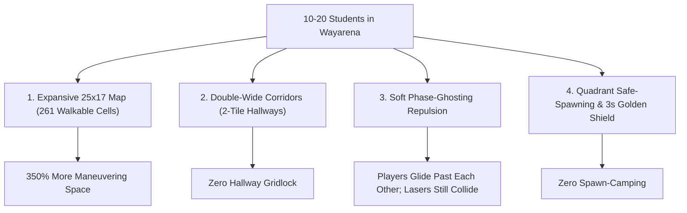
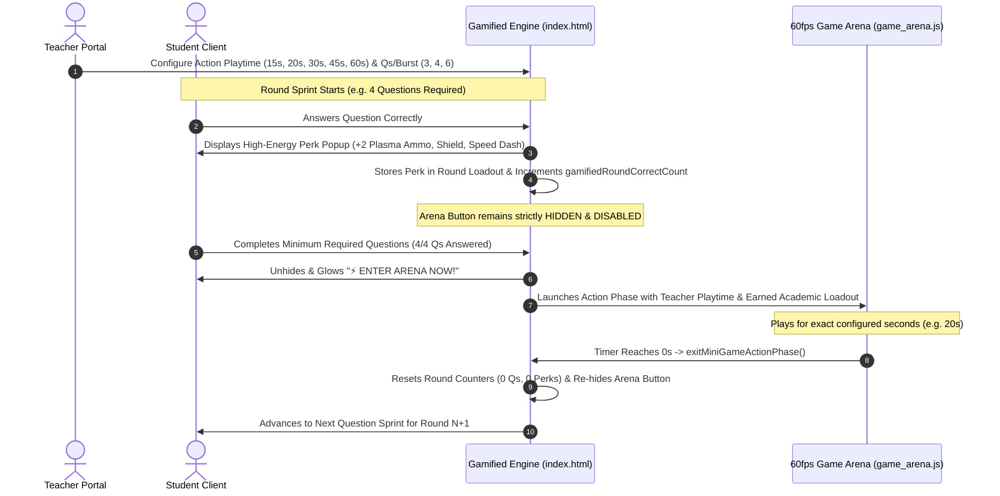
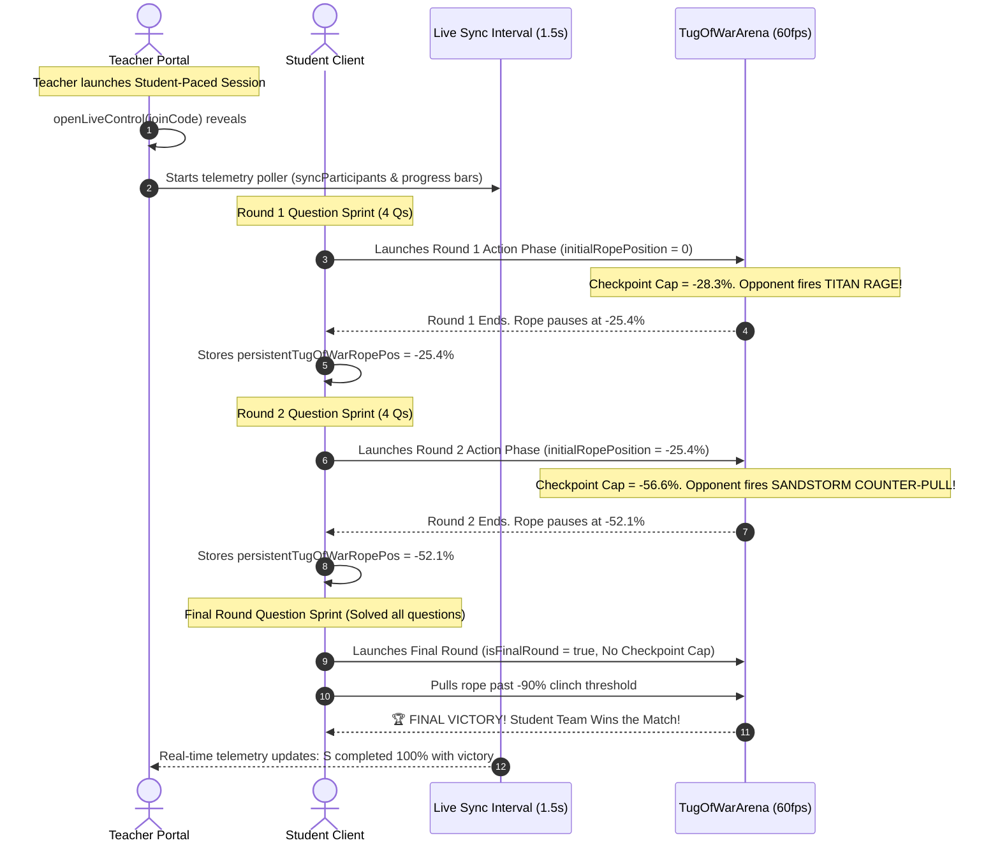
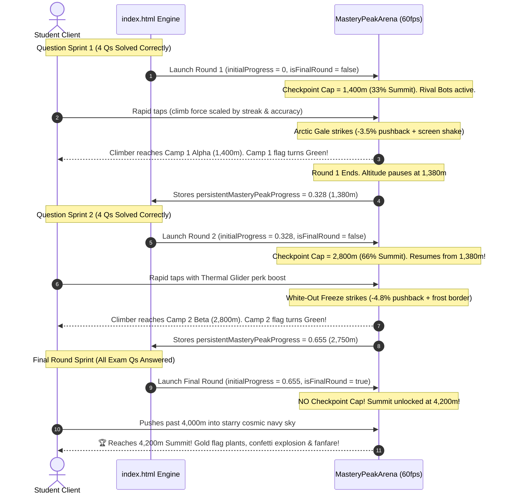
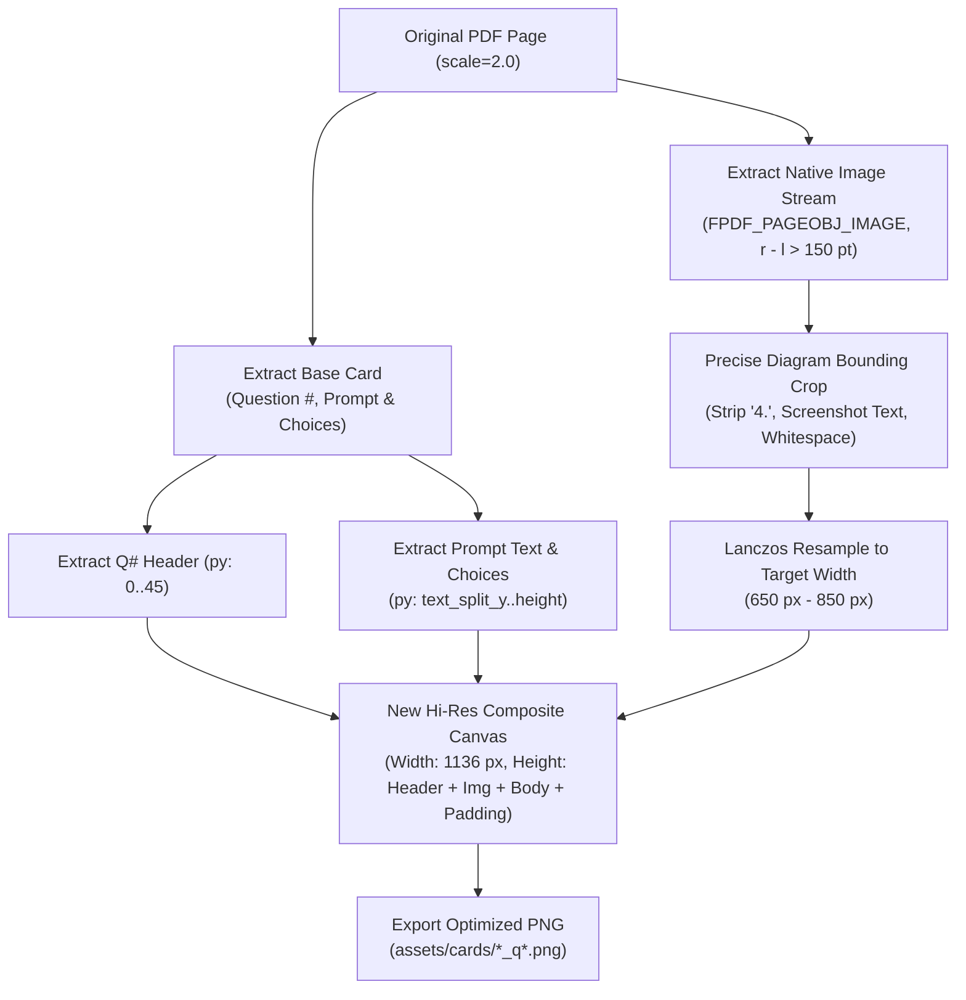

# VectorSelect by Mr. F — Master Implementation Specification (Supabase Edition)

## 1. Overview & System Architecture
VectorSelect is a high-performance web classroom assessment platform designed for AP Physics C: Mechanics. It supports both **Teacher-Led Synchronized Pacing** and **Student-Led Independent Modes**.

### Core Architecture
- **Frontend**: Pure vanilla modern JavaScript (ES6+), HTML5, Tailwind CSS, KaTeX math typesetting, and Lucide icons. Single-page zero-build architecture.
- **Backend**: Supabase (PostgreSQL with Realtime WebSockets & Row Level Security).
- **Static Hosting**: GitHub Pages, local HTTP server (`python -m http.server 8888`), or any static hosting provider.
- **Offline Reliability**: Gracefully falls back to offline answer keys (`data/answer_keys.js`), local assessment schemas, and HTML5 localStorage if the Supabase cloud service is unreachable.

---

## 2. Supabase Configuration & Key Placement

You have two flexible, fully-supported options to configure Supabase:

### Option A: `.env` File (Recommended for Local Dev & Git Safety)
Create a `.env` file in the root folder of the project (`VectorSelect by Mr. F/.env`):
```env
# Supabase Cloud Configuration
SUPABASE_URL=https://your-project-id.supabase.co
SUPABASE_ANON_KEY=eyJhbGciOiJIUzI1NiIsInR5cCI6IkpXVCJ9...
```
- **Git Protected**: `.env` and `.env.*` are already included in `.gitignore`, preventing accidental commits of your credentials.
- **Automatic Runtime Loading**: When served through any local HTTP server (such as `python -m http.server 8888` or VS Code Live Server), `supabase_config.js` automatically fetches and parses `.env` on startup.

### Option B: `supabase_public_config.js` (For Static Hosting / GitHub Pages)
If deploying statically to GitHub Pages or running without a local web server (direct `file:///`), open:
`VectorSelect by Mr. F/supabase_public_config.js`

Add your Supabase credentials:
```javascript
// Public Supabase configuration for the static frontend.
// Use the project URL and anon/publishable key only.
// Never put a service_role key in this file or any browser asset.
window.VECTORSELECT_SUPABASE_URL = "https://your-project-id.supabase.co";
window.VECTORSELECT_SUPABASE_ANON_KEY = "eyJhbGciOi...";
```

> **Security Note**: Only use your Supabase **Project URL** and **`anon` (public)** key. Database permissions and student isolation are secured on PostgreSQL using Row Level Security (RLS). Never expose your `service_role` secret key.

---

## 3. Database Schema Setup

Run the SQL script [`supabase_schema.sql`](supabase_schema.sql) in your **Supabase Dashboard → SQL Editor**:

### Tables Created
1. **`active_assignments`**:
   - Stores session state (`join_code`, `current_question_index`, `per_question_seconds`, `timer_remaining_seconds`, `timer_paused`, `discussion_active`, `answer_revealed`, `revealed_answer`, `revealed_explanation`).
   - Enables Realtime publication for instantaneous state broadcast across all student browsers.
2. **`answer_keys`**:
   - Stores authoritative College Board answer keys and rationales indexed by `assessment_id`.
3. **`exam_submissions`**:
   - Stores completed student exam records, points (0–120), streak data, and question breakdowns.
4. **`live_events`**:
   - Handles real-time student responses (`live_answer`), join notifications (`participant_join`), and floating emoji reactions (`emoji`).

---

## 4. Key Functional Mechanics

### A. Zero-Drift Timer Synchronization
- Teacher console broadcasts `timer_remaining_seconds` every 1 second.
- Student runner ticks at 1000ms intervals and locks directly into step with the teacher clock whenever updates arrive, eliminating any 1–2s drift.

### B. Instant Evaluation & Official Key Reveal
- When question time expires (`perQRemaining <= 0` or teacher clock hits 0) OR when the instructor clicks **End & Discuss** / **Reveal Key**:
  - Correct answer button turns vibrant emerald green (`.choice-correct`, `opacity: 1 !important`).
  - Student wrong selection turns coral red (`.choice-wrong`, `opacity: 1 !important`).
  - Official verdict banner appears with the College Board rationale/explanation.

### C. Clean Question State Transition
- Advancing to the next question (`advanceNow` / `isQuestionTransition`):
  - Clears `discussion_active` and `answer_revealed`.
  - Wipes previous question answers, locks, and evaluation banners.
  - Restores all choices (A, B, C, D) to clickable, interactive states.

### D. Single-Student Telemetry Accuracy
- Responses are deduplicated case-insensitively by student name and numeric question index, sorting by latest submission (`-created_at`), guaranteeing 1 student is never counted multiple times.

---

## 5. Replication Guide for Any IDE
1. Clone the repository into your local IDE workspace.
2. Provide your Supabase project credentials using either:
   - Create a `.env` file from `.env.example` with `SUPABASE_URL` and `SUPABASE_ANON_KEY`, **OR**
   - Fill in `window.VECTORSELECT_SUPABASE_URL` and `window.VECTORSELECT_SUPABASE_ANON_KEY` in `supabase_public_config.js`.
3. In your Supabase Dashboard SQL Editor, run `supabase_schema.sql` to initialize tables, indexes, and Realtime publications.
4. In your Supabase Dashboard SQL Editor, run `data/supabase_seed.sql` to populate all 120+ official answer keys into the `answer_keys` table.
5. Serve locally with Python (`python -m http.server 8888`) or open via VS Code Live Server.
6. Access:
   - Student Runner: `http://localhost:8888/index.html`
   - Teacher Console: `http://localhost:8888/teacher.html`

---

## 6. Verification & Production Deployment Status
- **Supabase Cloud Project**: Authenticated and connected via PostgREST API with PostgreSQL Row Level Security (RLS).
- **Database Schema**: Successfully provisioned via `supabase_schema.sql` (`active_assignments`, `answer_keys`, `exam_submissions`, `session_participants`, `live_question_answers`, `live_reactions`, and real-time triggers).
- **Official Answer Keys Seeded**: Successfully populated 106 assessments with complete College Board keys and explanations into `public.answer_keys` via `supabase_seed.sql`, verified live over PostgREST API.
- **Global CDN Delivery**: Static client configured with public credentials in `supabase_public_config.js` for worldwide classroom access on GitHub Pages.
- **Local Developer Security**: Root `.env` parser integrated into `supabase_config.js` with `.env` protected under `.gitignore`.

---

## 7. Teacher Live Control Layout & Zero-Abort Discussion Pipeline

### A. Static Header & Scrollable Stage Pane Layout (`teacher.html`)
- **Viewport Optimization**: Live control modal occupies the entire viewport (`z-50 p-2 sm:p-3 overflow-hidden`) without wasting vertical screen real-estate.
- **Permanent Static Top Anchor**: The top bar containing "Teacher-Led Live Session", Projector Mode badge, Quiz Title, the large high-contrast **CLASS JOIN CODE** (for late-arriving students), and modal close button (`✕`) is fixed (`shrink-0 border-b border-slate-800`) and **never scrolls**.
- **Independently Scrollable Stage Body**: Everything below the top header (`#lc-runner-body`) uses `overflow-y-auto overscroll-contain flex-1 min-h-0`. When scrolling, the HUD bar slides up smoothly, giving maximum vertical space to `#lc-stage-pane`.
- **Responsive High-Res Question Image**: `#lc-card-img` is configured with `max-w-full h-auto object-contain`, preventing any artificial down-scaling or blurry rendering so diagrams and LaTeX formulas remain razor sharp.
- **Unrestricted Wheel & Touch Navigation**: Removed artificial `preventDefault` event listener blocks so mouse-wheel, touchpad, and touch scroll natively and seamlessly throughout the modal.

### B. Non-Blocking "End & Discuss" Architecture
- **Zero-Abort Guarantee**: In `showDiscussionPanel()`, the early `return;` on missing answer keys has been eliminated. Clicking **💬 End & Discuss** ALWAYS:
  1. Pauses teacher timer and sets remaining seconds to 0.
  2. Broadcasts `{ discussion_active: true, timer_remaining_seconds: 0, timer_paused: true }` to Supabase `active_assignments`.
  3. Reveals official answer keys if available; if not yet seeded, safely marks key as pending while opening the discussion panel and rendering real-time choice distributions.
  4. Transforms the action button to **➔ Next Question (Answers Hidden)**.
  5. Opens `#lc-discussion-panel` and reveals the class response telemetry.

### C. Student Evaluation Revelation & Feedback Sync (`index.html`)
- **Evaluation Gate**: `isCurrentQuestionEvaluationRevealed()` returns `true` whenever:
  1. Instructor sets `answer_revealed` or sends `revealed_answer`, OR
  2. Instructor starts discussion (`discussionActive`), OR
  3. Question timer has expired (`perQRemaining <= 0`), and an official key is present.
- **Student Choice Highlighting**: Upon reveal:
  - Correct choice highlights in bright emerald green (`.choice-correct`).
  - Incorrect student choice highlights in coral red (`.choice-wrong`).
  - Neutral choices are dimmed (`.choice-dimmed`).
  - Locked banner transforms from neutral "Time Expired" to the official verdict banner with explanation.
- **Background Answer Key Preload**: `startExamRunner()` asynchronously hydrates answer keys from Supabase via `fetchAnswerKeysForQuiz(assessment_id)` in the background so evaluation is instant when time expires or instructor initiates discussion.

### D. Default Portal Settings
- **Default Quiz Mode**: `teacher_led` ("Teacher-Led (Synchronized)") is selected by default on portal launch.
- **Default Per-Question Pacing**: 90 Seconds Auto (`per_question_seconds: 90`) is configured as the active timer default, with the per-question box prominently displayed and the student self-paced overall timer hidden.
- **Double-Guarded Initialization**: Both HTML markup attributes (`selected`) and `initTeacherApp()` JavaScript state synchronization enforce this configuration whenever the teacher portal is opened or refreshed.

---

## 8. Watertight Question Transition & Unlocked Option State Architecture

### A. Root Causes of Question Transition Lock Bug
1. **Teacher Local Memory Desync**:
   - In `advanceNow()` and `lcPrevQuestion()`, when advancing questions, `setAssignmentTimerState` was dispatched to the server, but `currentLiveAssignment.question_started_at` in the teacher's local JavaScript object was never updated.
   - On the very next 250ms tick of `lcTimerInterval`, `getLiveQuestionRemaining()` computed `perQ - ((now - startedAt)/1000)`. Because `startedAt` was stale (from session launch minutes ago), `lcTimerRemaining` computed as `<= 0`.
   - The timer interval immediately fired `endCurrentQuestionDiscussion()`, invoking `showDiscussionPanel(..., true)`. This immediately broadcasted `discussion_active = true`, `answer_revealed = true`, and `revealed_answer = "A"` (or the key) to Supabase within 250ms of moving questions.
2. **Student Fall-Through Auto-Lock**:
   - In `syncStudentWithTeacherAssignment()` (`index.html`), when `isQuestionTransition` triggered, it cleared local answers and locks, but did **not** `return`.
   - When the immediate discussion broadcast arrived, lines 3201-3211 ran: `if (newDiscussion || newAnswerRevealed)`, immediately creating `studentLockedAnswers[currentReal] = { auto: true }` and locking the student screen on the new question.
3. **Student Premature `isTimeUp` & Answer Key Exposure**:
   - `isCurrentQuestionEvaluationRevealed()` previously evaluated `const isTimeUp = (typeof perQRemaining === 'number') && perQRemaining <= 0;`. In Manual Pacing or during transition before the countdown initialized, `isTimeUp` returned `true`.
   - `getQuestionCorrectAnswer()` returned `q.correct_answer` directly. When `isTimeUp` was true, `renderCurrentQuestion()` applied `choice-correct` (bright emerald green checkmark) to the correct option and disabled all buttons (`disabled = true`), making it appear to the student as if that option was already chosen and locked!
4. **Student Local Timer Auto-Lock at Zero**:
   - `updatePerQDisplay(secs)` called `autoLockCurrentQuestion()` whenever `secs <= 0`. In Manual Pacing or before `question_started_at` was set, `secs` was 0, prematurely triggering auto-lock.

---

### B. Comprehensive Architectural Fixes

#### 1. Teacher Console Synchronous Atomic Advancement (`teacher.html`)
- **Interval Clearing**: `clearInterval(lcTimerInterval)` is called synchronously at the beginning of `advanceNow()` and `lcPrevQuestion()`, halting any prior question's timer loop immediately.
- **Local Memory State Refresh**: `currentLiveAssignment` fields are updated synchronously before any asynchronous operations:
  ```javascript
  currentLiveAssignment.current_question_index = currentLiveIndex;
  currentLiveAssignment.question_started_at = nowIso;
  currentLiveAssignment.discussion_active = false;
  currentLiveAssignment.answer_revealed = false;
  currentLiveAssignment.revealed_answer = "";
  currentLiveAssignment.revealed_explanation = "";
  currentLiveAssignment.previous_correct_answer = prevCorrectKey;
  currentLiveAssignment.timer_remaining_seconds = perQ;
  currentLiveAssignment.timer_paused = false;
  currentLiveAssignment.paused_remaining_seconds = null;
  ```
- **Authoritative Server Broadcast**: Writes `nowIso` and reset states to Supabase `active_assignments`.
- **Timer Stale-Guard**: In `setupQuestionTimer()`, if `lcTimerRemaining <= 0` at startup, it is reset to `perQ` with a fresh `getServerNowIso()`, preventing any tick-0 expiration.

#### 2. Student Runner Clean Question Reset & Transition Early-Return (`index.html`)
- **Complete State Wipe on Transition**:
  ```javascript
  delete studentAnswers[newRealIdx];
  delete studentAnswers[teacherQ];
  delete studentLockedAnswers[newRealIdx];
  delete studentLockedAnswers[teacherQ];
  delete currentRevealedAnswers[teacherQ];
  delete currentRevealedAnswers[newRealIdx];
  delete currentRevealedExplanations[teacherQ];
  delete currentRevealedExplanations[newRealIdx];
  delete discussionFeedbackShownForQuestion[newRealIdx];
  delete recoveryAttemptedForQuestion[newRealIdx];
  ```
- **Reset Discussion & Freeze States**: Sets `discussionActive = false; answerRevealed = false;` and calls `updateDiscussionFreeze(false, false);`.
- **Fresh Choice Rendering**: Calls `renderCurrentQuestion();` with all choice buttons interactive, unlocked, and devoid of correct/wrong highlights.
- **Immediate Early Return**: `return;` is invoked immediately after the transition handling to prevent any stale discussion payload from the prior question or network race from falling through and auto-locking the newly loaded question.

#### 3. Strict Pedagogical Evaluation & Key Gating (`index.html`)
- **Guarded Evaluation Revealer**:
  ```javascript
  function isCurrentQuestionEvaluationRevealed() {
    if (quizMode === "teacher_led") {
      const hasTimer = Boolean(currentAssignment && Number(currentAssignment.per_question_seconds) > 0);
      const startedAt = Date.parse(currentAssignment && currentAssignment.question_started_at || "");
      const isTimeUp = hasTimer && Number.isFinite(startedAt) && (typeof perQRemaining === 'number') && perQRemaining <= 0;
      return (discussionActive || answerRevealed || isTimeUp);
    }
    return isCountDown && remainingSeconds <= 0;
  }
  ```
- **Confidential Answer Key Getters**: In `getQuestionCorrectAnswer()` and `getQuestionExplanation()`, in `teacher_led` mode, if `!isCurrentQuestionEvaluationRevealed()`, they strictly return `""`, ensuring no choice can be pre-highlighted in green before official instructor reveal.
- **Guarded Timer Local Lock**: `updatePerQDisplay(secs)` only calls `autoLockCurrentQuestion()` if `hasTimer && Number.isFinite(startedAt) && secs <= 0`.

---

## 9. Toast Deduplication & Question Card Canvas Drawing Architecture

### A. Toast Notification Deduplication
- **Duplicate Suppression in Host**: `showToast(title, body, theme, timeout)` checks if an identical toast (`data-toast-key="${title}:::${body}"`) is already mounted in `#toast-host`. If present, the duplicate request is discarded.
- **Single-Fire Evaluation Feedback**: `showDiscussionFeedback(realIdx, revealedKey, explanation)` checks `if (!discussionFeedbackShownForQuestion[realIdx]) { discussionFeedbackShownForQuestion[realIdx] = true; ... }` so each question's evaluation toast (e.g. "Correct: Q1 — Verified College Board key Option B") fires strictly once per discussion or timer expiry phase.
- **Redundant Sync Call Removal**: Cleaned up `syncStudentWithTeacherAssignment()` to prevent double-invoking `showDiscussionFeedback()`.

### B. Question Card Native Canvas Drawing Engine
- **Floating Circular Activation Badge**:
  - Located on the top-right corner of the question card (`#q-card-white-box`).
  - Circular button (`#btn-toggle-canvas`) toggles drawing mode on/off with visual cyan glow and status indicator ("Active" / "Off").
  - Matching `#hdr-btn-toggle-canvas` button in the top Question Header Bar.
- **Hover Popout Tool Suite (`#q-canvas-menu`)**:
  - **Option 1: Marker**:
    - Preset color palette: Crimson Red (`#ef4444`), Electric Cyan (`#06b6d4`), Highlighter Yellow (`#eab308`), Lime Green (`#22c55e`), and Purple (`#a855f7`).
    - Brush thickness pills: Thin (2px), Med (4px), Thick (8px).
  - **Option 2: Eraser**:
    - Eraser mode switches canvas `globalCompositeOperation` to `destination-out`, cleanly erasing annotations without modifying or degrading the underlying AP Physics question card image.
  - **Clear Tool**: Clears current question canvas markings with one tap.
- **Ratio-Normalized Vector Resolution (`xRatio`, `yRatio`)**:
  - Pointer coordinates are normalized as ratios: `xRatio = (clientX - rect.left) / rect.width`, `yRatio = (clientY - rect.top) / rect.height`.
  - When the browser window resizes, when students collapse the sidebar with **Expand Space**, or when switching zoom scales (100% / 120% / 140%), all strokes redraw with precision relative to the vector diagram.
- **Non-Destructive Pointer Interaction**:
  - When Drawing Mode is **Off**: `q-card-canvas` is set to `pointer-events: none;`. Clicking anywhere on the card opens the full-screen 125%+ vector inspector modal (`openImageModal`).
  - When Drawing Mode is **Active**: `q-card-canvas` switches to `pointer-events: auto;`. `onQuestionCardClick()` ignores zoom triggers, allowing natural stylus, finger touch, or mouse annotation directly across the problem card.
- **Per-Question Stroke Persistence**:
  - Drawings are stored per question index in `cardDrawStrokesByQuestion[realIdx]`.
  - Navigating back and forth preserves student working steps on each card.
- **Full Parity Across Both Portals**:
  - **Student Runner (`index.html`)**: Available on `#q-card-white-box` for personal sketching.
  - **Teacher Live Control & Projector Stage (`teacher.html`)**: Available on `#lc-card-box` via `#btn-toggle-teacher-canvas` with full marker/eraser toolset for whole-class instruction, diagram breakdown, and vector derivations on smartboards or projectors.

---

## 10. Header Branding & Attribution Single-Line Layout

- **Problem**: In narrow viewports or responsive flex containers, the "by Mr. F" attribution badge lacked strict wrapping constraints, allowing "BY MR." and "F" to break across two lines awkwardly.
- **Resolution**:
  - In both `index.html` and `teacher.html`, the brand row container was updated to `flex flex-wrap items-center gap-2`.
  - Added `whitespace-nowrap shrink-0` to the wordmark (`VectorSelect`), the attribution card (`by Mr. F`), and the portal badges (`Student Portal` / `Teacher Hub`).
  - Guarantees the "by Mr. F" badge remains rendered seamlessly as an unbroken, single-line pill across all device screen widths.

---

## 11. Gamified Student-Paced Quizzes, Game Duration Studio & AAA Mini-Games Engine

### A. System Architecture & Capabilities
VectorSelect features an interactive student-paced gamification suite inspired by Wayground, Quizizz, and Blooket, elevated with:
1. **60fps Hi-DPI Canvas Rendering**: Crisp, vector-proportional graphics with dynamic particle systems (dust, splashes, confetti) and spring physics.
2. **Pedagogical Mechanics Integration**: Mini-games are tied directly to AP Physics mechanics (Newton's Laws $F = ma$ and friction in *Tug of War*; Work-Energy Theorem $\Delta U_g = mgh$ in *Mastery Peak*).
3. **Pure Web Audio API Sound Synthesizer**: Procedural synthesized sounds (clicks, rope whooshes, correct jingles, error buzzes, powerups, victory fanfares) with zero external audio assets, zero download lag, and 100% offline capability.
4. **Deterministic Wall-Clock Timer**: Eliminates timer drift across background tab throttling using absolute timestamp differences:
   $$\text{Remaining Time} = \text{GameEndTime} - \text{Date.now}()$$

---

### B. Database & State Schema Extensions

#### PostgreSQL Schema (`supabase_schema.sql`)
Added to `public.active_assignments`:
```sql
alter table public.active_assignments add column if not exists game_mode text not null default 'classic';
alter table public.active_assignments add column if not exists game_duration_minutes integer not null default 5;
alter table public.active_assignments add column if not exists questions_per_round integer not null default 4;
alter table public.active_assignments add column if not exists show_answer_timing text not null default 'immediate';
alter table public.active_assignments add column if not exists student_accommodations boolean not null default true;
```

#### Client Normalization (`supabase_config.js`)
- Whitelisted in `CLOUD_ASSIGNMENT_COLUMNS` for cloud persistence.
- Hydrated in `normalizeAssignment()` with local fallbacks (`game_mode: "classic"`, `game_duration_minutes: 5`, `questions_per_round: 4`, `show_answer_timing: "immediate"`, `student_accommodations: true`) for seamless offline running.

---

### C. Teacher Portal: Mode Selection Hub & Game Studio (`teacher.html`)

1. **Activity Mode Cards Hub**:
   - Visual cards for **Classic** (Synchronized teacher-led), **Mastery Peak** (Self-paced ascent), **Playground** (Arcade & duel), **Test Mode** (Formal mock exam), and **Team Mode** (Co-op duel).
2. **Student-Paced Gamified Controls Box (`#student-gamified-controls-box`)**:
   - Automatically unhides when "Student-Led (Self-Paced)" is selected in `<select id="teacher-quiz-mode">`.
   - Displays 4 interactive game cards:
     - ⚡ **Wayarena Battle**: Vector laser shootout in a sci-fi maze with AI bots & 4 powerups.
     - ⚔️ **Tug of War**: High-energy beach rope pull powered by question accuracy.
     - ⛰️ **Mastery Peak**: Climb 4,200m alpine summit; repeat missed concepts.
     - 📝 **Classic Exam**: Standard student-paced AP assessment with zero mini-games.
   - Master Game Duration dropdown (3m, 5m, 7m, 10m, 15m, 20m, 30m).
   - Questions-per-burst segmented pills (3 Qs, 4 Qs, 6 Qs) with dynamic hint text.
   - One-click shortcut button to open the full 60fps Game Studio modal.
3. **Game Selection & Configuration Studio Modal (`#game-studio-modal`)**:
   - Live 60fps Canvas preview running `GameArena.createMazeBattlePreview()`, `createTugOfWarPreview()`, or `createMasteryPeakPreview()`.
   - Comprehensive rulebook modal (`showGameRulesModal()`) detailing Wayarena laser combat, powerups, and scoring.
   - Direct dispatch button with accommodations toggle and show-answer modes.

---

### D. High-Fidelity Canvas Mini-Game Engine (`data/game_arena.js`)

- **Hi-DPI Responsive Canvas Setup**: Auto-calibrates against `devicePixelRatio` (up to 2.5x) with dynamic proportional rendering.
- **Procedural Chibi Physicist Avatars**: Cute helmet characters with responsive facial expressions (straining during pull, smiling on streaks, blinking).
- **Tug of War Beach Arena**:
  - Parallax sky with animated clouds and distant island.
  - Sine-wave oscillating turquoise ocean surf.
  - Golden sand dunes with chalk center line.
  - Dynamic catenary rope with center red ribbon marker and spring tension.
  - Interactive clickable wooden barrels with bouncing spring transforms.
  - Particle emitters for sand dust, water splashes, and victory confetti.
- **Mastery Peak Alpine Arena**:
  - Gradient mountain peaks with snow caps and summit flag.
  - Winding trail with 4 altitude waypoints and climber avatar.
  - Continuous falling snow particle simulation.
- **Wayarena (Sci-Fi Vector Maze Battle)**:
  - **Grid & Maze Topology**: 15x11 retro-futuristic labyrinth with laser-cut perimeter and neon-lit interior corridors.
  - **Real-Time Ballistics**: Vector lasers with bounding collision checks, 2-bounce reflection vectors, and sparkling energy decay.
  - **AI Bots**: 3 autonomous bots (*NewtonBot*, *GalileoBot*, *KeplerBot*) with raycast line-of-sight targeting, randomized patrol vectors, and smart obstacle avoidance.
  - **Dynamic Power-Ups**:
    - ⚡ *Quantum Dash*: +80% thruster velocity boost for fast flanking.
    - 🛡️ *Kinetic Shield*: Invulnerability bubble and deflection barrier.
    - 💥 *Triple Blast*: 3-way spread laser cannons for room-clearing coverage.
    - 💣 *Graviton EMP*: Radial 360-degree shockwave detonation that stuns and clears nearby opponents.
  - **Input Schemes**: Full keyboard (WASD / Arrow Keys + Space to fire) plus on-screen touch D-Pad and Fire button for Chromebooks and iPads.
  - **Combat Feedback**: Knockout kill feed, HP/Shield bars, recharge indicators, and particle explosions.
- **Web Audio API Synthesizer (`GameArena.SoundFX`)**:
  - `click()`: 800Hz $\rightarrow$ 300Hz sine chirp (30ms).
  - `tug()`: 140Hz $\rightarrow$ 65Hz triangle whoosh with low-pass impact.
  - `correct()`: Four-note major triad arpeggio (C5, E5, G5, C6).
  - `wrong()`: 180Hz sawtooth buzz.
  - `laser()`: 920Hz $\rightarrow$ 210Hz futuristic frequency modulation blip.
  - `hit()`: Low-pass filtered noise crunch for ballistic impact.
  - `explosion()`: Sub-bass decay rumble with distortion.
  - `powerup()`: Rising 320Hz $\rightarrow$ 880Hz square wave sweep.
  - `victory()`: Multi-oscillator 4-note victory fanfare.

---

### E. Student Runner Gamified Pacing Loop & Victory Podium (`index.html`)

1. **Gamified Arcade HUD (`#gamified-arcade-hud`)**:
   - Dynamic game title badge (⚔️ *Tug of War*, ⛰️ *Mastery Peak*, ⚡ *Wayarena*).
   - Round tracker (`Round 1`, `Round 2`, etc.) and progress bar (`X / Y Qs`).
   - Master Game Clock: Large amber font displaying deterministic countdown (`05:00`) synchronized to `Date.now()`.
2. **Knowledge Phase $\rightarrow$ Action Phase Rhythm**:
   - Student answers AP Physics multiple-choice questions.
   - Each correct answer boosts the **Quiz Power Multiplier** (`x1.25`, `x1.50`, etc.) and plays synthesized sound effects.
   - Upon reaching the round target (e.g. 4 questions), screen unlocks the **Action Phase** (`#gamified-arena-modal`).
   - Student plays a high-energy mini-game round (15s for Tug of War; 25s for Wayarena):
     - In *Tug of War*, tapping barrels applies rope pulls amplified by their quiz accuracy multiplier!
     - In *Wayarena*, student navigates the sci-fi maze, blasts bot classmates, picks up power-ups, and racks up knockouts!
   - When the round concludes, victory fanfare sounds and student seamlessly returns to the next question set.
3. **Master Game Completion & Victory Podium (`#gamified-results-podium`)**:
   - When the master game duration hits `0:00`, the session finishes with celebratory fanfare.
   - The results screen reveals a **3D-Style Victory Podium** displaying:
     - 1st, 2nd, and 3rd place champions with custom player and bot standings.
     - Total Knockouts / Pull Advantage / Summit Altitude metrics.
     - Total Mini-Game Rounds cleared.
     - Arcade Mastery Rank (e.g., *Quantum Apex*, *Vector Striker*, *Titan Puller*).
   - Coexists harmoniously with standard AP Physics score, accuracy percentage, time spent, Concept Mastery Breakdown, and College Board rationale review.
4. **Schema Resilience & URL Param Hydration**:
   - `createAssignmentOnCloud` and `updateAssignment` automatically catch PostgreSQL error `42703` (missing column) and re-dispatch safely without dropping assignments.
   - Student join URLs include `?join=CODE&game=wayarena&mins=5&qround=4`, ensuring 100% gamified fidelity even before cloud migrations are run.

---

### F. Multi-IDE Replication Checklist
To replicate this gamified architecture in another IDE (VS Code, Cursor, WebStorm):
1. **Schema**: Run the new columns migration in your Supabase SQL editor:
   ```sql
   alter table public.active_assignments add column if not exists game_mode text not null default 'classic';
   alter table public.active_assignments add column if not exists game_duration_minutes integer not null default 5;
   alter table public.active_assignments add column if not exists questions_per_round integer not null default 4;
   alter table public.active_assignments add column if not exists show_answer_timing text not null default 'immediate';
   alter table public.active_assignments add column if not exists student_accommodations boolean not null default true;
   ```
2. **Config**: Include `"game_mode"`, `"game_duration_minutes"`, `"questions_per_round"`, `"show_answer_timing"`, `"student_accommodations"` in your state normalization dictionary (`supabase_config.js`).
3. **Engine**: Copy `data/game_arena.js` into your static asset folder.
4. **Teacher Portal**: Add `#student-gamified-controls-box` and `#game-studio-modal` markup and handlers to `teacher.html`.
5. **Student Portal**: Add `#gamified-arcade-hud`, `#gamified-arena-modal`, `#gamified-results-podium`, and the round progress handlers to `index.html`.
6. **Zero Dependencies**: Requires zero build steps (`npm`, `webpack`, `vite` not required) — runs purely in vanilla JavaScript, Web Audio API, and HTML5 Canvas on any static server or web platform.

---

## 12. 2.5D Chibi Physics Battlers & Mouse-Aim Ballistics System (Wayarena Engine Upgrade)

### A. Context & Architectural Rationale
In earlier builds, top-down maze combat rendered abstract 2D circular discs with colored slice arcs, and the canvas overlay mistakenly displayed a static barrel-tapping prompt from Tug of War. This caused confusion regarding game mechanics and character identities.

To deliver an engaging, intuitive classroom experience comparable to Brawl Stars, Gimkit, and Blooket, the Wayarena engine in `data/game_arena.js` was upgraded to a **2.5D Procedural Chibi Battlers & Mouse-Aim Ballistics System**.

---

### B. Procedural 2.5D Chibi Battlers (`drawBattleAvatar`)
Every combatant is rendered purely via mathematical Canvas 2D vector primitives—ensuring zero external sprite sheet downloads, instant offline startup, and crisp rendering on Retina / Hi-DPI displays.

1. **Depth & Grounding**:
   - Translucent black elliptical drop shadow beneath feet (`rgba(0, 0, 0, 0.45)`).
2. **Animated Locomotion**:
   - Alternating running boots with dynamic stride oscillation: `legOffset = isMoving ? Math.sin(walkCycle) * 4 : 0`.
   - Boot base with character-themed sole accents.
3. **Armored Torso & Reactor Core**:
   - Dark battle armor chassis with colored chestplate.
   - Center glowing reactor core pulsing at `Math.sin(time * 6)`.
4. **Vector Plasma Blaster Rifle & Muzzle Flash**:
   - Dual-tone carbine body with neon energy heatsink and extended muzzle.
   - Gloved hands gripping foregrip and trigger stock.
   - Blaster rotates continuously around the character center to track aiming `angle`.
   - Dynamic muzzle flash burst flares on discharge for 4 frames.
5. **Cute Chibi Head & Anime Expression**:
   - Warm skin tone (`#fed7aa`) with soft rosy blushing cheeks.
   - Large anime eyes with colored irises, pupils, and white specular highlights.
   - Angled eyebrows conveying battle focus.
   - Cheerful determined battle smile.
6. **Distinct Historical Scientist Personas**:
   - **Player ("You")**: Spiky hero anime hair with neon cyan streak, plus a cyber holographic monocle visor over the right eye with HUD reticle.
   - **NewtonBot**: Powdered white baroque curls cascading around his head, paired with a golden apple chest emblem.
   - **GalileoBot**: Brunette wavy scientist hair, professor beard, and brass celestial stargazing goggles on forehead.
   - **KeplerBot**: Emerald astronaut dome helmet with an orbiting planetary ring antenna and orbiting gold planetoid.
7. **Kinetic Shield Bubble**:
   - 3D translucent cyan spherical bubble with glowing neon rim and rotating orbital nodes.
8. **Overhead Status Display**:
   - Multi-segment health bar (green $\rightarrow$ yellow $\rightarrow$ red gradient).
   - High-contrast player name badge (`YOU [P1]`, `NewtonBot [AI]`, etc.).
   - Active powerup indicator tag (`⚡ SPEED`, `💥 3-WAY`, `💣 EMP`).

---

### C. Decoupled Movement & Precision Mouse-Aiming
The player's input model was decoupled from directional movement:
- **Desktop (Mouse & Keyboard)**:
  - **Movement**: `W, A, S, D` and Arrow Keys smoothly steer the character through corridors with continuous wall collision checking.
  - **Aiming**: Moving the mouse over the canvas calculates the exact angle towards the cursor.
  - **Targeting Laser Sight**: A high-tech dotted neon guide line projects from the blaster muzzle directly to the crosshair reticle at the cursor position.
  - **Firing**: Left-clicking anywhere on the canvas or pressing Spacebar fires directly along the targeting beam.
- **Mobile & Touch**:
  - Touch-dragging moves and steers the player.
  - Dedicated on-screen **FIRE ⚡** button fires lasers without interrupting movement.
- **Dynamic Overlay Instructions**:
  - `#arena-overlay-hint` in `index.html` dynamically displays:
    - *Wayarena*: `"🎯 WASD: Move • Mouse: Aim • Click / Space: BLAST bots & grab powerups!"`
    - *Tug of War*: `"👆 Tap wooden barrels or screen rapidly to pull the rope!"`
    - *Mastery Peak*: `"👆 Tap screen rapidly to climb the icy summit!"`

---

### D. Floating Combat Text & Juiced Visual Feedback
1. **`FloatingTextEmitter`**:
   - Hits: `💥 -1 HP` floating upward and fading.
   - Shield blocks: `🛡️ BLOCKED!` in bright cyan.
   - Knockouts: `👑 ELIMINATED! +150 PTS` in gold.
   - Respawns: `🔄 RESPAWNING...` with temporary immunity shield.
   - Powerup pickup: Floating banner announcing `⚡ SPEED BOOST!`, `🛡️ KINETIC SHIELD!`, `💥 3-WAY BLASTER!`, `💣 GRAVITON EMP BLAST!`.
2. **Camera Impact Shake**:
   - Hits and knockouts trigger subtle 2D canvas translation shake (`this.shake = 8`), adding punchy arcade weight.
3. **Powerup Supply Crates**:
   - Floating 3D supply crates with rotating orbital plasma rings and clear floating badges (`[ ⚡ SPEED ]`, `[ 🛡️ SHIELD ]`, `[ 💥 3-WAY ]`, `[ 💣 EMP ]`).

---

### E. Replication Checklist for Other IDEs
When replicating in another environment:
1. Ensure `FloatingTextEmitter` is initialized in your game loop.
2. Bind both `pointermove` and `pointerdown` with `e.pointerType` checks to distinguish touch drag from desktop mouse aim.
3. Set line dash `[4, 4]` on canvas context for the targeting laser sight.
4. Scale all avatars proportionally using `cellW` and `cellH` from `setupHiDpi(canvas)`.


---

## 13. Teacher Portal 3-Step Guided Wizard & Student-Paced Frictionless Review Architecture

### A. Architectural Overview & Design Motivation
The Teacher Portal (`teacher.html`) was redesigned from a cluttered vertical control stack into a modern, focused **3-Step Guided Wizard** inspired by top gamified learning platforms (Wayground, Kahoot, Blooket). The interface provides clear visual separation, eliminates decision fatigue, and introduces high-contrast, color-coded interactive tiles.

Crucially, **1-click startup speed** is preserved via the **"⚡ Quick Launch"** option on Step 1.

Additionally, in `index.html`, the artificial `[ 🔒 Lock In Answer ]` gate has been removed for **Student-Paced** assignments, enabling smooth and agile question solving. When the exam timer ends (or submission occurs), the assignment automatically locks, enabling students to review all questions with correct (green) and incorrect (red) feedback and official College Board scoring rationales.

```mermaid
flowchart TD
  subgraph TeacherPortal["Teacher Portal (teacher.html)"]
    W1["Step 1: Quiz & Features<br/>(Course, Unit, AP Quiz + Toggles)"]
    W1 -->|"Next &rarr;"| W2["Step 2: Pacing Mode<br/>(Teacher-Led vs Student-Led)"]
    W2 -->|"Student-Led"| W3A["Step 3A: Mini-Game & Duration<br/>(Wayarena, Tug of War, Mastery Peak, Classic)"]
    W2 -->|"Teacher-Led"| W3B["Step 3B: Projector Confirmation<br/>(Synchronized 90s Interval)"]
    W3A --> Lobby["Dedicated Live Class Lobby<br/>(6-Digit Code, QR Code, Direct URL)"]
    W3B --> Lobby
    W1 -.->|"⚡ Quick Launch"| Lobby
  end

  subgraph StudentRunner["Student Runner (index.html)"]
    SActive["Student-Paced Active Sprint<br/>(Click A/B/C/D freely - NO Lock Button)"]
    SActive -->|"Timer at 0:00 or Submit"| SLocked["Auto-Locked Exam State<br/>(Read-Only Choices)"]
    SLocked --> SReview["Full Review Mode<br/>(&#10003; Green / &#10007; Red + College Board Rationales)"]
  end
```



---

### B. Teacher Portal 3-Step Guided Dispatcher (`teacher.html`)

1. **Stepper Header Navigation**:
   - Element: `#wizard-stepper-pills` with `.step-pill` components.
   - Tabs:
     - `1. Quiz & Features` (`#step-tab-1`): Active on initial load.
     - `2. Pacing Mode` (`#step-tab-2`): Enabled once assessment is chosen.
     - `3. Game & Launch` (`#step-tab-3`): Final configuration deck.
   - Helper function: `goToWizardStep(stepNumber)` validates required selections and smoothly toggles step containers with `.enter` CSS animations.

2. **Step 1: Assessment Selection & Integrity Features (`#wizard-step-1`)**:
   - **Cascading Selectors**:
     - `#teacher-select-subject` (Course) $\rightarrow$ `#teacher-select-unit` (Unit) $\rightarrow$ `#teacher-select-assessment` (Quiz).
   - **Live Assessment Summary Card** (`#selected-quiz-summary-card`):
     - Displays course badge, unit badge, assessment title, question count (`15 MCQs • AP Rigor`), and `#btn-preview-quiz` ("👁️ Preview Questions").
   - **Pedagogical & Integrity Toggles**:
     - `🧮 Allow Calculator` (`#opt-calc`, default ON).
     - `🏆 Show Leaderboard` (`#opt-leaderboard`, default ON).
     - `🔒 Lockdown Mode` (`#opt-lockdown`, default OFF).
     - `🔀 Shuffle Questions` (`#opt-randomize`, default OFF).
     - `📋 Allow Students to Review Answers & Explanations` (`#opt-review`, default ON).
     - `🎮 Enable Point Redemption & Physics Sims` (`#opt-point-redemption`, default ON).
   - **Footer Controls**:
     - Left: `⚡ Quick Launch (Default Settings)` button (`quickLaunchAssignment()`). Dispatches immediately with 1 click using default settings.
     - Right: `Next: Choose Pacing Mode →` button (`#btn-step1-next`, enabled once quiz is chosen).

3. **Step 2: Pacing Mode Selection (`#wizard-step-2`)**:
   Two large, Wayground-inspired high-contrast interactive cards:
   - **Teacher-Led (Synchronized Projector)** (`#pacing-card-teacher`):
     - *Styling*: Deep Royal Purple / Indigo border & gradient (`border-2 border-purple-500 bg-purple-950/40`).
     - *Badge*: `📽️ PROJECTOR MODE`.
     - *Description*: All students advance together in lockstep with instructor pacing.
     - *Built-in Preset*: `#teacher-per-question` dropdown (Manual / 30s / 45s / 60s / 90s Recommended / 120s).
   - **Student-Led (Self-Paced & Gamified)** (`#pacing-card-student`):
     - *Styling*: Vibrant Cyan / Emerald border & gradient (`border-2 border-cyan-400 bg-cyan-950/40`).
     - *Badge*: `🎮 MINI-GAMES & SPRINT`.
     - *Description*: Students solve questions independently at their own speed with mini-game bursts.
     - *Built-in Preset*: `#teacher-time-limit` dropdown (Untimed / 5m / 10m / 15m / 20m / 30m / 45m / 60m).

4. **Step 3: Mini-Game Setup & Confirmation (`#wizard-step-3`)**:
   - **Student-Led Branch (`#step3-student-games-panel`)**:
     - 4 Vibrant Wayground Mini-Game Tiles:
       1. ⚡ **Wayarena Battle** (`#tg-card-wayarena`): Amber/Orange neon laser shootout with chibi battlers, bots & powerups.
       2. ⚔️ **Tug of War** (`#tg-card-tug_of_war`): Electric cyan beach rope pull powered by question accuracy.
       3. ⛰️ **Mastery Peak** (`#tg-card-mastery_peak`): Mint/Emerald alpine ascent with snow particles & concept remediation.
       4. 📝 **Classic AP Exam** (`#tg-card-classic`): Slate/Indigo continuous assessment with zero mini-games.
     - Parameters: `#teacher-game-duration` (Master Clock) and `#teacher-questions-per-round` (3 Qs, 4 Qs, 6 Qs).
     - Launch button: **"🚀 Launch Student-Led Session"** (`handleCreateAssignment()`).
   - **Teacher-Led Branch (`#step3-teacher-summary-panel`)**:
     - Displays assessment summary, per-question interval, and active integrity rules.
     - Launch button: **"🚀 Launch Teacher Projector Lobby"** (`handleCreateAssignment()`).

5. **Dedicated Class Lobby Screen (`#wizard-lobby-container`)**:
   Immediately upon clicking Launch, the card smoothly transitions into the waiting lobby:
   - **Giant Join Code**: `#banner-code` in emissive gold plasma font (`text-5xl sm:text-6xl md:text-7xl font-black font-mono`).
   - **Auto-Generated QR Code**: `#banner-qr-code` dynamically hydrated via `api.qrserver.com` SVG/PNG ready for instant scanning by mobile/tablet cameras.
   - **Direct URL**: One-click "📋 Copy Direct Link" button (`copyShareUrl()`).
   - **Live Student Counter**: Green pulsing dot with live participant counter (`#lobby-student-count`).
   - **Mode-Specific Primary Action**:
     - Teacher-Led: `🚀 Enter Projector Control Deck (Start Class)` $\rightarrow$ opens `#live-control-modal`.
     - Student-Led: `📊 Monitor Live Student Progress` $\rightarrow$ scrolls to active assignments table.
   - **"↻ New Dispatch"** button (`resetWizard()`) to reset the stepper for another class.

---

### C. Student-Paced Frictionless Answering & Auto-Locked Review (`index.html`)

1. **Removal of the Forced Lock-In Gate**:
   - In `renderCurrentQuestion()`:
     - When `quizMode === "student_led"` and the test is active (`!isExamLocked && !isExamSubmitted`):
       - No `#q-lock-status-box` with `[ 🔒 Lock In Answer ]` is rendered.
       - Students click choice buttons (A, B, C, D) directly.
       - Clicking another choice immediately updates `studentAnswers[realIdx]` and active highlights (`choice-selected`).
       - If a prior question was missed and point redemption is enabled, the recovery lab is accessible directly without requiring a manual lock button.
   - In `selectChoice(letter)`:
     - `if (quizMode === "teacher_led" && studentLockedAnswers[realIdx]) return;`
     - In `student_led` mode, students can switch answers freely anytime before submission or timer expiration.

2. **Auto-Lock on Time Expiration & Submission**:
   - When the countdown reaches `0:00` in `setInterval`:
     ```javascript
     isExamLocked = true;
     isExamSubmitted = true;
     clearInterval(timerInterval);
     finishAssessment();
     ```
   - In `finishAssessment()`:
     - Sets `isExamLocked = true` and `isExamSubmitted = true`.
     - In student-paced mode, `allowReview` is automatically set to `true`, revealing `#btn-review-answers`.

3. **Comprehensive Review Mode**:
   - In `#view-review`:
     - Renders every question card with student choice, official answer key, and College Board scoring rationale.
   - In the interactive question runner (`#view-exam-runner`):
     - When `isExamLocked || isExamSubmitted`:
       - All choice buttons are disabled.
       - Correct answer choice is highlighted in green (`choice-correct`).
       - If student selected an incorrect choice, it is highlighted in red (`choice-wrong`).
       - Official College Board Scoring Rationale card is rendered directly below the choices.
       - Navigation buttons ("← Previous Question", "Next Question →", and grid buttons) remain active so students can step through all questions.
       - In `updateGridHighlights()`, navigation buttons for correct questions are tinted green (`bg-emerald-950 text-emerald-300 border-emerald-500`), while incorrect questions are tinted red (`bg-rose-950 text-rose-300 border-rose-500`), providing an immediate visual map of exam results.

---

### D. Replication Checklist for Other IDEs
1. **DOM ID Compatibility**: Ensure all legacy selectors (`teacher-select-subject`, `teacher-select-unit`, `teacher-select-assessment`, `teacher-quiz-mode`, `banner-code`, `banner-url`, `opt-calc`) exist in your markup so database dispatches and event handlers continue to operate without null pointer exceptions.
2. **QR Code Generation**: Use a clean URL-encoded QR endpoint (`api.qrserver.com` or local SVG generator) populated during assignment creation.
3. **Decoupled Lock Gate**: Ensure `studentLockedAnswers` is checked only when `quizMode === "teacher_led"`, while `student_led` relies on `isExamLocked` / `isExamSubmitted`.
4. **Scoring Rationales**: Hydrate `q.explanation` before rendering review cards to ensure zero-key leakage during the exam and full explanatory access in review mode.

## 14. Wayarena Battle: Brick-Spawn Bugfix & 10–20 Student Anti-Crowding Architecture (`data/game_arena.js`)

### A. Root Cause Analysis of Brick Entrapment
1. **Hardcoded Wall Coordinate Overlap**:
   - In previous iterations, `MazeBattleArena.start()` and `hitEntity()` initialized player and bot positions as:
     ```javascript
     this.player.x = cellW * 2.5; // Col index 2
     this.player.y = cellH * 2.5; // Row index 2
     ```
   - In `MAZE_MAP[2][2]`, the grid tile was explicitly `1` (Wall). The player and two bots were literally instantiated inside solid wall cells.
2. **Permanent Collision Deadlock**:
   - `isWall(x, y, radius)` evaluates the bounding box corners against the grid. Because the player's initial coordinates were already inside a wall, `isWall(nextX, y)` and `isWall(x, nextY)` both returned `true` for all directions, freezing player velocity to 0 permanently.
3. **Single-Tile Corridor Bottlenecks**:
   - Hallways were only 1 tile wide (~32px). With `radius = 12px`, characters had virtually zero margin for error when turning corners.

---

### B. Anti-Crowding Architecture for 10–20 Students

To scale the top-down arena from 1 player + 3 bots to a lively classroom environment (10–20 students) without gridlocks or spawn camping, four architectural systems were implemented:



#### 1. Expansive 25x17 Tactical Arena Map
- Upgraded map from 15x11 to a **25x17 grid** (425 cells total, 261 walkable cells, 61.4% open space):
  - **Double-Wide Hallways (2-tile corridors)**: Hallways are at least 2 tiles wide (~48–60px), allowing students to sprint side-by-side or cross in opposite directions without collision lock.
  - **4 Quadrant Outposts**:
    - **Sector 0 (Alpha Outpost NW)**: Kinetic Shield Crate 🛡️
    - **Sector 1 (Beta Outpost NE)**: Quantum Dash Crate ⚡
    - **Sector 2 (Gamma Outpost SW)**: Triple Laser Crate 💥
    - **Sector 3 (Delta Outpost SE)**: Graviton EMP Crate 💣
  - **Center Core Plaza (Rows 6–10, Cols 8–16)**: Wide open combat arena with 4 defensive corner cover pillars and a central Plasma Overcharge Crate ⭐.

#### 2. Dynamic Quadrant Safe-Spawning
- Implemented `getSpawnCoordinates(sectorIndex)`:
  ```javascript
  const spawnGridTiles = [
    { col: 3, row: 2 },   // Sector 0 (Alpha Outpost NW)
    { col: 21, row: 2 },  // Sector 1 (Beta Outpost NE)
    { col: 3, row: 14 },  // Sector 2 (Gamma Outpost SW)
    { col: 21, row: 14 }, // Sector 3 (Delta Outpost SE)
    { col: 12, row: 8 }   // Sector 4 (Central Core Plaza)
  ];
  ```
  Guarantees 100% of spawns and respawns occur in open plaza centers with verified zero wall overlap.

#### 3. Exact Circle-to-AABB Wall Collision & Unstick Ejection
- Replaced 4-corner sampling with mathematically exact **circle-to-AABB distance clamping**:
  ```javascript
  const nearestX = Math.max(c * cellW, Math.min(x, (c + 1) * cellW));
  const nearestY = Math.max(r * cellH, Math.min(y, (r + 1) * cellH));
  const distSq = (x - nearestX) * (x - nearestX) + (y - nearestY) * (y - nearestY);
  if (distSq < radius * radius - 0.05) return true;
  ```
- Added `unstickEntity(entity)`: If an entity ever overlaps a wall cell (due to sudden resize or lag), a 3x3 neighborhood scan immediately nudges the entity to the nearest open pathway center.

#### 4. Soft Phase-Ghosting Repulsion (No Physical Corridor Deadlocks)
- Rigid circle-to-circle collision between players is replaced with **Soft Spring Repulsion**:
  ```javascript
  let edx = e2.x - e1.x;
  let edy = e2.y - e1.y;
  let edist = Math.hypot(edx, edy);
  if (edist < 0.01) {
    edx = (Math.random() - 0.5) || 0.1;
    edy = (Math.random() - 0.5) || 0.1;
    edist = Math.hypot(edx, edy);
  }
  const minSep = e1.radius + e2.radius + 2;
  if (edist < minSep) {
    const overlap = (minSep - edist) * 0.18;
    const nx = edx / edist;
    const ny = edy / edist;
    if (!this.isWall(e1.x - nx * overlap, e1.y, e1.radius)) e1.x -= nx * overlap;
    if (!this.isWall(e1.x, e1.y - ny * overlap, e1.radius)) e1.y -= ny * overlap;
    if (!this.isWall(e2.x + nx * overlap, e2.y, e2.radius)) e2.x += nx * overlap;
    if (!this.isWall(e2.x, e2.y + ny * overlap, e2.radius)) e2.y += ny * overlap;
    e1.phaseRipple = 6;
    e2.phaseRipple = 6;
  }
  ```
- **Player Experience**: Students can smoothly pass each other in doorways and hallways. An idle or slow student can never block a corridor or trap classmates!
- **Visuals**: A soft cyan phase-ripple glow triggers around overlapping avatars.
- **Combat Integrity**: Laser projectiles still register direct hits on any entity regardless of ghosting.

#### 5. 3-Second Golden Respawn Shield
- Upon spawning or respawning, entities receive `invulnerableTimer = 180` (3 seconds at 60fps).
- While active:
  - Incoming laser hits deal 0 damage and trigger `'🛡️ IMMUNE!'` floating feedback.
  - Avatar is surrounded by a glowing golden energy bubble with orbiting stars/runes.
  - Completely eliminates spawn camping and instant knockouts.

#### 6. Tactical Mini-Radar HUD
- Integrated an 84x56 px radar in the corner of the canvas:
  - Sweep scanline effect.
  - Real-time color-coded blips for player (cyan glow) and all bots/classmates (persona colors).
  - Displays map awareness for all 10–20 students simultaneously.

---

### C. Replication Checklist for Other IDEs / Game Frameworks
1. **Corridor Sizing**: Always ensure minimum corridor width is at least `2.5 * entityDiameter` when 10+ players share a top-down arena.
2. **Coordinate Matrix Conversion**: When converting grid matrix indices `(row, col)` to world pixel coordinates, always center entities: `x = (col + 0.5) * cellW`, `y = (row + 0.5) * cellH`.
3. **Axis Decoupling in Velocity**: Move horizontal (`nextX`) and vertical (`nextY`) independently:
   ```javascript
   if (!isWall(nextX, y, radius)) x = nextX;
   if (!isWall(x, nextY, radius)) y = nextY;
   ```
   This provides frictionless wall sliding around corners.
4. **Soft-Body Separation**: In multiplayer educational games, never use rigid hard-body collisions between friendly players; use soft-spring repulsion to prevent trolling, griefing, and accidental bottlenecks.

## 15. Student-Paced Gamified Pacing: Teacher Playtime Control, Strict Arena Gating, Per-Question Perk Popups & Academic Loadout Wiring

### A. Problem Statement & Pedagogical Core
In gamified student-paced sessions (Wayarena, Tug of War, Mastery Peak), gameplay bursts must be earned through verified physics problem-solving. Previous limitations included:
1. **Uncontrolled Arena Duration**: The action phase timer was hardcoded to 25s/15s rather than configurable by the instructor.
2. **Early Arena Access Leak**: The manual "🎮 Arena" button was visible and openable before students answered the required number of questions.
3. **Missing Perk Feedback**: When students solved a question correctly, they received no immediate visible feedback about what combat/gameplay perk they had unlocked for the upcoming arena burst.
4. **Disconnected Academic Performance**: Mini-games started with identical baseline loadouts regardless of whether a student scored 100% or 0% during the question sprint.

---

### B. Architecture & Data Flow



---

### C. Technical Implementation Details

#### 1. Teacher-Configured Playtime Duration (`teacher.html`)
- **UI Selector Added**:
  - `#teacher-action-duration` in Wizard Step 3 grid.
  - `#studio-action-duration` in Game Studio Modal.
  - Options: `15s (Quick Burst)`, `20s (Standard - Recommended)`, `30s (Extended Battle)`, `45s (Long Skirmish)`, `60s (Full 1-Min Duel)`.
- **Dynamic Wizard Hint**:
  ```javascript
  function updateTeacherRoundHint(gameId, n) {
    const hint = document.getElementById("teacher-round-hint");
    if (!hint) return;
    const durationEl = document.getElementById("teacher-action-duration") || document.getElementById("studio-action-duration");
    const secs = durationEl ? (parseInt(durationEl.value, 10) || 20) : 20;
    if (gameId === "wayarena") {
      hint.textContent = `${n} questions solved unlocks each ${secs}s neon maze combat burst.`;
    } ...
  }
  ```
- **Assignment Dispatch & URL Serialization**:
  - `assignmentData.action_phase_seconds` stored in Supabase payload.
  - Serialized into student direct join link: `&action_secs=${actionPhaseSecs}`.

#### 2. Strict Arena Gating (`index.html`)
- **Hidden by Default**:
  `#btn-manual-arena-open` starts with `class="hidden ..."` and `disabled`.
- **Visual Gating in `updateGamifiedRoundHUD()`**:
  ```javascript
  const arenaBtn = document.getElementById("btn-manual-arena-open");
  if (arenaBtn) {
    if (gamifiedRoundQuestionsAnswered >= gamifiedQuestionsPerRound) {
      arenaBtn.classList.remove("hidden");
      arenaBtn.disabled = false;
      arenaBtn.innerHTML = `<span>⚡ ENTER ARENA NOW!</span>`;
      arenaBtn.className = "pressable px-4 py-2.5 rounded-xl bg-gradient-to-r from-emerald-500 to-cyan-500 hover:from-emerald-400 hover:to-cyan-400 text-slate-950 font-black text-xs shadow-lg shadow-cyan-500/30 transition flex items-center gap-1.5 animate-pulse cursor-pointer";
    } else {
      arenaBtn.classList.add("hidden");
      arenaBtn.disabled = true;
    }
  }
  ```
- **Functional Gate in `triggerMiniGameActionPhase(isManual)`**:
  ```javascript
  if (gamifiedRoundQuestionsAnswered < gamifiedQuestionsPerRound) {
    showToast("Arena Gated", `Solve ${gamifiedQuestionsPerRound - gamifiedRoundQuestionsAnswered} more questions to unlock the arena!`, "copper", 2000);
    return;
  }
  ```

#### 3. Celebratory Per-Question Perk Popups (`#gamified-perk-popup`)
- Created a centered quantum card overlay with glassmorphism backdrop glow that auto-fades after 1.9s (or instantly closes upon click).
- Perk mappings tailored specifically for each game mode:
  - **Wayarena**:
    - Q1: `🔋 +2 Plasma Ammo` (Extra blaster rounds loaded into magazine)
    - Q2: `🛡️ Kinetic Energy Shield` (+30 Shield absorption against enemy lasers)
    - Q3: `⚡ Quantum Boots (+20% Speed)` (Dash quickly through arena corridors)
    - Q4: `💥 3-Way Spread Blaster` (Fires triple plasma bolts simultaneously)
    - Q5+: `⭐ Golden Overdrive` (Supercharged damage & speed boost)
  - **Tug of War**:
    - Q1: `💪 +0.25x Pull Momentum` (Increases team pull power)
    - Q2: `👟 High-Grip Cleats` (+20% traction against opposing bots)
    - Q3: `🔥 Adrenaline Surge` (x1.5 tap multiplier during rope pulls)
    - Q4: `⚓ Mega Anchor Stance` (Heavy resistance against enemy pulls)
    - Q5+: `🏆 Champion Titan Pull` (Maximum pulling torque unlocked)
  - **Mastery Peak**:
    - Q1: `🧗 +150m Altitude Boost` (Instant height advantage at start)
    - Q2: `🫁 Oxygen Respirator` (+25% tapping stamina against wind gusts)
    - Q3: `⛏️ Ice Pick Grapple` (Secure footing past slippery crevasses)
    - Q4: `🦅 Thermal Jet Glider` (Double climb velocity during summit sprint)
    - Q5+: `🏔️ Peak Conqueror Aegis` (Immunity to icy blizzards)

#### 4. Instant Question Scoring & Evaluation Reveal
- When a student selects an option in student-led gamified mode (`selectChoice(letter)`):
  - Answer is immediately stored in `studentLockedAnswers` and `gamifiedScoredQuestions`.
  - `isCurrentQuestionEvaluationRevealed()` returns `true` for scored questions, applying `choice-correct` (emerald glow) or `choice-wrong` (crimson red) badges immediately.
  - Options become disabled to prevent answer manipulation or perk farming.
  - `onStudentAnswerLockedInGamified(isRight)` triggers the unlock popup and sound effects.

#### 5. Academic Loadout Injection into `game_arena.js`
- Student accuracy in the question sprint directly determines their avatar stats:
  ```javascript
  const loadout = {
    healthBonus: gamifiedRoundCorrectCount * 15,
    shield: gamifiedRoundCorrectCount >= 2 ? 30 : 0,
    ammo: 10 + (gamifiedRoundCorrectCount * 3),
    threeWay: gamifiedRoundCorrectCount >= 3,
    speedBoost: gamifiedRoundCorrectCount >= 4 ? 0.20 : 0,
    bonusText: `${gamifiedRoundCorrectCount}/${gamifiedQuestionsPerRound} Correct! Loadout: +${gamifiedRoundCorrectCount * 3} Ammo${gamifiedRoundCorrectCount >= 2 ? ' + Shield' : ''}${gamifiedRoundCorrectCount >= 3 ? ' + 3-Way' : ''}`
  };
  ```
- Passed into `window.GameArena.createMazeBattleGame(canvas, loadout)`.
- Action timer is initialized strictly to `gamifiedActionPhaseSecs`:
  ```javascript
  let actionRemaining = gamifiedActionPhaseSecs || (gamifiedGameMode === "wayarena" ? 25 : 15);
  ```

#### 6. Clean Round Transitions & Counter Resets
- In `exitMiniGameActionPhase()`:
  - `gamifiedRoundQuestionsAnswered = 0`
  - `gamifiedRoundCorrectCount = 0`
  - `gamifiedCurrentRound++`
  - `updateGamifiedRoundHUD()` (instantly resets progress bar to 0% and hides `#btn-manual-arena-open`)
  - Calls `nextQuestion()` to start the next question sprint.

---

### D. Replication Checklist for Other IDEs
1. **Gating State Verification**: Ensure the action trigger button is conditionally rendered or toggled via CSS class (`hidden`), with defensive server/state guards so API calls cannot force early execution.
2. **Pedagogical Perk Mapping**: Define an explicit JSON map linking academic correct answers to in-game mechanics so students immediately associate intellectual diligence with gameplay power.
3. **Decoupled Round Reset**: Always reset both answered count and correct count in the phase exit handler to ensure loadouts are recalculated cleanly per round sprint.
4. **URL Query Compatibility**: Parse both database attributes and URL search parameters (`action_secs`, `mins`, `qround`, `game`) to ensure direct link joins preserve teacher settings across devices.


## 16. Teacher Portal Live Progress Monitor Deck, Wayarena Multiplayer Bot Cap & Tug of War Multi-Round Episodic Architecture

### A. Problem Statement & Root Cause Analysis

1. **Teacher Portal "Monitor Live Student Progress" Inaction**:
   - In `teacher.html` (line 2589), when creating a student-led session in `handleCreateAssignment()`, the primary action button (`#btn-lobby-live-action`) executed:
     ```javascript
     primaryBtn.onclick = () => {
       document.getElementById("active-assignments-container").scrollIntoView({ behavior: 'smooth' });
     };
     ```
     This merely scrolled the page down to the table instead of launching the live monitor control deck or activating real-time telemetry polling.
   - In `loadAssignmentsTable()` (line 2792), the table row rendering logic checked `if (quiz_mode === 'teacher_led')`, omitting the `📊 Monitor Progress` action button for all `student_led` sessions.
   - In `startLiveAssignmentNow()` (line 3705), starting a student-led session immediately called `closeLiveControlModal()`, instantly dismissing the teacher's overview screen and leaving the teacher with no way to watch student sprint progress in real time.

2. **Wayarena Bot Overcrowding in Multiplayer Classrooms**:
   - When 5 to 20 students joined a Wayarena session, the engine was still spawning 4 autonomous AI bots into the arena. This congested corridors and distracted human players from competing against one another.
   - Requirement: When player headcount exceeds 5 (`playerCount > 5`), the arena must strictly spawn **zero AI bots** (`this.bots = []`).

3. **Tug of War Gameplay Triviality & Missing Episodic Continuity**:
   - In previous builds, tapping anywhere pulled the rope by 1.5, while the initial burst pulled by 17 units. Outside of preview mode, the opponent bot possessed zero AI counter-pull logic. A student could drag the rope completely to `-100` within 3 to 4 taps before the timer expired.
   - Every round reset the rope position back to `0`, discarding all prior progress and destroying the sense of sustained athletic/intellectual struggle across the exam.
   - Requirement:
     - The opponent bot must actively counter-pull and trigger dramatic **Special Powers** (`⚡ TITAN RAGE SURGE!`, `🌪️ SANDSTORM COUNTER-PULL!`, `⚓ MEGA ANCHOR STAMPEDE!`).
     - Pull progress must be capped by **Round Checkpoints** (Round 1: ~28%, Round 2: ~56%, Round 3: ~85%). The student must **not be able to win** in early rounds; ultimate victory is earned only in the final round after solving all questions and stacking perks.
     - The rope position must pause and persist across rounds (`persistentTugOfWarRopePos`), resuming seamlessly in Round 2 from where Round 1 paused.

---

### B. Architecture & Data Flow



---

### C. Technical Implementation Details

#### 1. Teacher Portal Live Progress Monitor Deck (`teacher.html`)

- **Primary Action Handler**:
  In `handleCreateAssignment()`:
  ```javascript
  primaryBtn.textContent = "📊 Monitor Live Student Progress";
  primaryBtn.className = "pressable px-6 py-4 rounded-xl bg-gradient-to-r from-emerald-500 to-cyan-500 hover:from-emerald-400 hover:to-cyan-400 text-slate-950 font-black text-sm shadow-xl shadow-cyan-500/25 transition flex items-center justify-center gap-2 cursor-pointer";
  primaryBtn.onclick = () => {
    openLiveControl(code);
  };
  ```
- **Active Assignments Table Monitor Button**:
  In `loadAssignmentsTable()`:
  ```javascript
  const isStudentLed = (a.quiz_mode === "student_led" || a.quiz_mode === "gamified");
  const actionBtn = isTeacherLed ?
    `<button onclick="openLiveControl('${a.join_code}')" class="px-3 py-1.5 rounded-lg bg-indigo-600/30 hover:bg-indigo-600/50 text-indigo-300 border border-indigo-500/40 font-bold text-xs transition">📽️ Control Live</button>` :
    `<button onclick="openLiveControl('${a.join_code}')" class="px-3 py-1.5 rounded-lg bg-emerald-600/30 hover:bg-emerald-600/50 text-emerald-300 border border-emerald-500/40 font-bold text-xs transition">📊 Monitor Progress</button>`;
  ```
- **Non-Dismissing Live Runner**:
  In `startLiveAssignmentNow()`:
  ```javascript
  if (isStudentPaced) {
    // Keep modal open, transition into live runner body
    lobbyBody.classList.add("hidden");
    runnerBody.classList.remove("hidden");
    headerBadge.textContent = "STUDENT-PACED TELEMETRY";
    headerBadge.className = "text-[10px] font-black px-2.5 py-0.5 rounded-full bg-emerald-950 text-emerald-400 border border-emerald-800 tracking-wider";
    
    // Start continuous 1.5s live sync poller
    if (liveSyncInterval) clearInterval(liveSyncInterval);
    liveSyncInterval = setInterval(syncLiveAssignmentState, 1500);
    syncLiveAssignmentState();
  }
  ```

#### 2. Wayarena Multiplayer Bot Cap (`data/game_arena.js`)

In `MazeBattleArena.start()`:
```javascript
const effectivePlayerCount = (this.loadout && this.loadout.playerCount) ? this.loadout.playerCount : 1;

if (effectivePlayerCount > 5) {
  // STRICT RULE: If human player count > 5, spawn ZERO AI bots to prevent corridor crowding
  this.bots = [];
} else {
  // Scale bots proportionally: maximum 5 combatants total on the field
  const botsToSpawn = Math.max(1, 5 - effectivePlayerCount);
  this.bots = botProfiles.slice(0, botsToSpawn).map((p, i) => {
    const coords = this.getSpawnCoordinates(i + 1);
    return {
      id: `bot_${i}`,
      name: p.name,
      x: coords.x,
      y: coords.y,
      vx: 0, vy: 0,
      radius: 13,
      health: 80,
      maxHealth: 80,
      color: p.color,
      isBot: true,
      decisionTimer: Math.floor(Math.random() * 30),
      aimAngle: Math.random() * Math.PI * 2,
      kills: 0,
      speed: 2.1
    };
  });
}
```

In `index.html`:
- Participant counter in `updateLobbyParticipants()` stores `lastKnownConnectedStudents = parts.count || 1`.
- In `triggerMiniGameActionPhase()`, `playerCount: lastKnownConnectedStudents` is injected directly into `loadout` and passed into `createMazeBattleGame(canvas, loadout)`.

#### 3. Tug of War Multi-Round Episodic Engine (`data/game_arena.js` & `index.html`)

- **Configurable Options & State Persistence**:
  `TugOfWarArena` constructor accepts an options object:
  ```javascript
  constructor(canvas, options = {}) {
    this.initialRopePos = typeof options.initialRopePosition === 'number' ? options.initialRopePosition : 0;
    this.ropePosition = this.initialRopePos;
    this.targetRopePosition = this.initialRopePos;
    this.currentRound = options.currentRound || 1;
    this.totalRounds = options.totalRounds || 3;
    this.isFinalRound = options.isFinalRound || false;
    this.powerMultiplier = options.powerMultiplier || 1.0;
    this.correctCount = options.correctCount || 0;
    
    // Checkpoint cap: student cannot win until the final round!
    this.maxProgressThisRound = this.isFinalRound ? -100 : -1 * Math.min(85, Math.max(25, (this.currentRound / this.totalRounds) * 85));
  }
  ```
- **Round Checkpoint Gate**:
  In `pullLeft(amount)`:
  ```javascript
  pullLeft(amount = 1.6) {
    if (this.ropePosition <= this.maxProgressThisRound && !this.isFinalRound) {
      this.targetRopePosition = this.maxProgressThisRound;
      this.showOpponentWarning(`⚓ ROUND ${this.currentRound} CHECKPOINT REACHED! OPPONENT ANCHORS DOWN!`);
      return;
    }
    const scaledPull = amount * Math.min(2.0, Math.max(0.7, this.powerMultiplier));
    this.targetRopePosition = Math.max(this.maxProgressThisRound, this.targetRopePosition - scaledPull);
  }
  ```
- **Opponent Bot Active AI Counter-Tension**:
  In `update()` loop:
  ```javascript
  // Continuous gentle baseline tension
  this.targetRopePosition += 0.04;
  
  // Opponent Special Powers Trigger (every 3–5 seconds)
  this.opponentPowerTimer++;
  if (this.opponentPowerTimer >= this.nextOpponentPowerInterval) {
    this.opponentPowerTimer = 0;
    this.nextOpponentPowerInterval = 180 + Math.floor(Math.random() * 120);
    this.triggerOpponentSpecialPower();
  }
  ```
- **Opponent Special Power Arsenal**:
  1. `⚡ TITAN RAGE SURGE!`: Opponent pulls with +8.0 force, fiery aura sparks.
  2. `🌪️ SANDSTORM COUNTER-PULL!`: Opponent pulls with +9.5 force, disorienting dust particles.
  3. `⚓ MEGA ANCHOR STAMPEDE!`: Opponent anchors hard and violently heaves rope by +11.5 force.
  - Accompanied by a floating on-screen warning banner, opponent avatar rage pulse, and arcade thud sound effects.
- **Rope Persistence in `index.html`**:
  ```javascript
  // On exiting action phase:
  if (gamifiedGameMode === "tug_of_war" && studentArenaInstance) {
    persistentTugOfWarRopePos = studentArenaInstance.ropePosition || 0;
    totalGamifiedRopePull += Math.max(0, Math.round(Math.abs(studentArenaInstance.ropePosition || 0)));
  }
  
  // On starting a new exam:
  persistentTugOfWarRopePos = 0;
  ```

---

### D. Replication Checklist for Other IDEs

1. **Modal Body Transition**: When switching from classroom lobby to student telemetry, keep the root modal container open and swap inner body containers (`lobbyBody.classList.add('hidden')`, `runnerBody.classList.remove('hidden')`) to preserve poller state without screen flickers.
2. **Participant Headcount Reflection**: Never hardcode multiplayer entity counts; pass dynamic lobby count into game constructors so arenas can adjust bot populations dynamically.
3. **Multi-Round Rope Persistence**: In episodic minigames, store game progress (`ropePosition`, `altitude`, `inventory`) in outer module-scoped variables (`persistentTugOfWarRopePos`) between action phase modal closes.
4. **Episodic Progression Caps**: To prevent students from finishing a minigame in Round 1, calculate proportional progress caps (`currentRound / totalRounds`) that lock further advancement until subsequent question rounds are completed.

## 17. Mastery Peak AAA Interactive Summit Engine, Multi-Round Altitude Persistence, Arctic Hazards & 3-Game Ecosystem Harmonization

### A. Problem Statement & Root Cause Analysis

1. **Mastery Peak Non-Interactivity**:
   - In previous builds, `MasteryPeakArena` was purely passive: it possessed zero click, pointer, or touch event listeners. While the student UI prompted *"Tap screen rapidly to ascend past wind gusts!"*, tapping had zero effect on the climber sprite.
   - Initial progress hardcoded `progress = 0.35` (1,470m) every round, disregarding all prior climbs and resetting progress when the action phase closed.
   - The climber was completely alone with zero rival climber bots or classmate representation.
   - There was zero resistance: no headwind drift, blizzards, or avalanches resisting the climb.
   - There were no round checkpoint altitude caps; progress was decoupled from the overall question sprint structure.

2. **Phantom `code_busters` Discrepancy in Teacher Game Studio**:
   - In `teacher.html` (lines 1013–1025), the Game Studio modal listed a legacy mock card for `CODE BUSTERS` ("Hack vaults and steal gems!").
   - However, `CodeBustersArena` was never written in `data/game_arena.js`, and Step 3 of the teacher wizard had already replaced it with `classic` ("Classic Exam"). Selecting `code_busters` in the studio resulted in broken previews or fallbacks to Tug of War.

---

### B. Architecture & Data Flow



---

### C. Technical Implementation Details

#### 1. Interactive Climbing Engine & Mechanics (`data/game_arena.js`)

- **Interactive Pointer & Touch Listeners**:
  ```javascript
  this.onClick = this.onClick.bind(this);
  if (!this.isPreview) {
    this.canvas.addEventListener('click', this.onClick);
    this.canvas.addEventListener('touchstart', this.onClick, { passive: true });
  }
  ```
- **Climbing Propulsion (`climb(step)`)**:
  - Base step is scaled by the student's active streak multiplier (`powerMultiplier`), question accuracy (`correctCount`), and earned perks (`thermalJetGlider` / `speedBoost`):
    ```javascript
    const mult = Math.max(1.0, this.powerMultiplier);
    const accBonus = 1.0 + (this.correctCount * 0.1);
    const perkBoost = (this.loadout && this.loadout.threeWay) ? 1.25 : 1.0;
    const force = step * mult * accBonus * perkBoost;
    ```
  - Emits ice chink dust particles at climber trail coordinates and plays climbing audio synthesis (`SoundFX.click()`).
- **Round Checkpoint Altitude Caps**:
  - In non-final rounds:
    ```javascript
    const roundFraction = Math.min(1.0, this.currentRound / Math.max(1, this.totalRounds));
    const maxProgressThisRound = Math.min(0.88, Math.max(0.28, roundFraction * 0.88));
    if (nextProgress >= maxProgressThisRound) {
      nextProgress = maxProgressThisRound;
      this.statusBannerText = `⛺ CAMP ${this.currentRound} CHECKPOINT REACHED! Rest for next sprint!`;
      this.statusBannerTimer = 55;
    }
    ```
  - In the final round, students can push past 0.98 to 1.0 (4,200m), triggering `SoundFX.victory()`, golden flag illumination, and celebratory summit banners.

#### 2. Dynamic Arctic Hazards (Gales, White-Outs & Avalanches)

- Natural high-altitude headwind drift constantly pulls target progress slightly downward:
  ```javascript
  this.targetProgress = Math.max(this.initialProgress, this.targetProgress - 0.00025);
  ```
- Dynamic Arctic Hazards trigger every 3 to 5 seconds:
  1. `🌪️ ARCTIC GALE PULLBACK!` (-3.5% altitude pushback, gale-force snow drift).
  2. `❄️ WHITE-OUT FREEZE SURGE!` (-4.8% altitude pushback, frost screen-border vignette).
  3. `🏔️ AVALANCHE ROCKFALL!` (-6.5% altitude pushback, camera shake translation `this.shake = 8`, splash debris).
- Students who earned the `Peak Conqueror Aegis` / `Kinetic Shield` perk take 50% reduced hazard pushback (`netPush = h.push * 0.5`).

#### 3. Multiplayer Bot Scaling (>5 Players = 0 Bots)

- Applied strictly in `MasteryPeakArena`:
  ```javascript
  const effectivePlayerCount = (this.options && this.options.playerCount) ? this.options.playerCount : 1;
  if (effectivePlayerCount > 5) {
    this.rivals = []; // STRICT RULE: Zero AI bots in rooms with >5 students
  } else {
    const botCount = Math.max(1, 4 - effectivePlayerCount);
    // Spawns Yeti Scout, Glacier Bot, Alpine AI pacing along the trail
  }
  ```
- Trail Standing Leaderboard HUD displays real-time placement (`🏆 1ST PLACE (Lead!)` vs `🏃 2ND PLACE (Chasing)`).

#### 4. Multi-Round State Persistence (`index.html`)

- Outer module-scoped variable: `let persistentMasteryPeakProgress = 0;`.
- In `triggerMiniGameActionPhase()`:
  - Passes `initialProgress: persistentMasteryPeakProgress` into `createMasteryPeakGame`.
  - Applies initial sprint accuracy surge: `studentArenaInstance.climb(gamifiedRoundCorrectCount * 0.015)`.
- In `exitMiniGameActionPhase()`:
  - `persistentMasteryPeakProgress = studentArenaInstance.progress || 0;`
  - `totalGamifiedAltitude = Math.round(persistentMasteryPeakProgress * 4200);`
- In `startExamRunner()`: resets `persistentMasteryPeakProgress = 0;`.

#### 5. 3-Game Ecosystem Harmonization (`teacher.html`)

- Replaced legacy mock card `card-game-code_busters` in the Game Studio modal with `card-game-classic` ("Classic Exam").
- Both the **Teacher Step 3 Wizard** and the **Game Studio Modal** are now 100% synchronized with the 3 core mini-games + Classic Exam:
  1. ⚡ **Wayarena Battle** (`wayarena`): 2.5D Chibi sci-fi vector maze shooter.
  2. ⚔️ **Tug of War** (`tug_of_war`): Beach rope duel with opponent Titan Powers.
  3. ⛰️ **Mastery Peak** (`mastery_peak`): 4,200m alpine summit ascent with blizzards & camp checkpoints.
  4. 📝 **Classic AP Exam** (`classic`): Pure assessment mode with College Board timers & rationale reviews.

---

### D. Replication Checklist for Other IDEs

1. **Trail Coordinate Interpolation**: Pre-calculate piecewise linear segments for mountain trails `[(0, 0.88), (0.35, 0.68), (0.65, 0.46), (0.50, 0.20)]` so avatars move smoothly across non-linear 2D heights.
2. **Dynamic Sky Gradient Shift**: Transition canvas background gradients based on elevation percentage (Teal valley -> Twilight ridge -> Cosmic navy with twinkling stars).
3. **Passive Touch Handling**: Always pass `{ passive: true }` to `touchstart` event listeners on mobile devices to prevent browser scroll lag during rapid clicking.
4. **Episodic Minimum Floor**: When hazard pushback occurs, ensure `Math.max(this.initialProgress, this.targetProgress - netPush)` so students never lose progress earned in prior completed question rounds.


---

## 14. AP Physics C Midterm Review Card Ingestion & Image Clarity Architecture

### A. Context & Identified Defects
During classroom review sessions for **AP Physics C: Mechanics Unit 2 Midterm Review** (`appc_unit2_midterm_review`), two severe presentation defects were identified:
1. **Truncated Question Stems & Missing Choices (Q9)**:
   - Question 9 (Astronaut inside spaceship on a scale) was cropped prematurely at `y = 336.8 pt`, cutting off the final prompt sentence:
     > *"Based only on observing the scale reading, which of the following is the most accurate?"*
     and amputating all 4 answer choices (A, B, C, D).
2. **Illegibly Tiny Image Question Stems (Q13)**:
   - Question 13 (Two satellites in circular orbit around Earth) had its entire question prompt embedded as a miniature $184.5 \times 14.2\text{ pt}$ image inside Quizizz/Wayground printable worksheets.
   - At standard rendering scale, two full lines of dense mathematical physics text were squeezed into a 14 pt vertical strip, rendering the problem stem completely unreadable to students.

---

### B. Root Cause Analysis
1. **PDF Text Stream Ordering Mismatch**:
   - The legacy cropping logic in `scripts/ingest_midterm_reviews.py` located the bottom of the last question on each page by searching backwards in the character string:
     ```python
     cutoff = text.rfind('04/10/2026')
     last_idx = cutoff - 1
     box_last = tp.get_charbox(last_idx)
     crop_bottom = min(h - 25.0, (h - box_last[1]) + 15.0)
     ```
   - In PDF object architecture, the physical order of characters in the content stream does **not** equal visual reading order from top to bottom.
   - On Page 5 (Q9), mathematical symbols and superscripts (e.g. the exponent `2` in $\text{m/s}^2$) appeared late in the text stream but were physically positioned at $y = 284\text{ pt}$ (in the middle of the page).
   - This caused `box_last[1]` to evaluate to the vertical center of the page, prematurely terminating the crop and truncating over 100 points ($200+\text{ px}$) of essential question content.
2. **Quizizz Thumbnail Constraint on Question Prompts**:
   - In Q13, the question stem was authored as an external image and uploaded to Quizizz.
   - Quizizz printable templates force all image elements into a fixed $184.5\text{ pt}$ column width.
   - For wide images ($1584 \times 118\text{ px}$, aspect ratio $13.4:1$), forcing width to $184.5\text{ pt}$ crushed the height down to $14.2\text{ pt}$ ($28.5\text{ px}$), shrinking the font size to $\approx 5\text{ px}$.

---

### C. Architectural Fixes & Implementation

#### 1. Robust Visual Coordinate Bounding-Box Detection
The cropping algorithm in `scripts/ingest_midterm_reviews.py` was rebuilt to evaluate the true physical bounds of all rendered elements on the page:
- For any question that is the last question on a page, instead of relying on linear character index searches, the engine scans **every non-whitespace character** and **every image object** on the page.
- Elements starting above `crop_top - 5.0 pt` and residing above the footer threshold (`y < 762.0 pt`) contribute to `max_y`:
  ```python
  max_y = crop_top + 50.0
  for c in range(len(text)):
      if not text[c].isspace():
          c_box = tp.get_charbox(c)
          c_bot = h - c_box[1]
          c_top = h - c_box[3]
          if c_top >= crop_top - 5.0 and c_bot < 762.0:
              if c_bot > max_y:
                  max_y = c_bot

  for obj in page.get_objects():
      if obj.type == pdfium.raw.FPDF_PAGEOBJ_IMAGE:
          l, b, r, t = obj.get_bounds()
          obj_bot = h - b
          obj_top = h - t
          if obj_top >= crop_top - 5.0 and obj_bot < 762.0:
              if obj_bot > max_y:
                  max_y = obj_bot

  crop_bottom = min(h - 22.0, max_y + 16.0)
  ```
- Generous padding (`+16.0 pt`) ensures fractions, sub-choices, and square root radicals (e.g. Q4 and Q15) retain full visual clarity without clipped denominators.

#### 2. Native-Resolution Question Stem Compositing (Q13)
For Q13, the script extracts the native $1584 \times 118\text{ px}$ uncompressed image directly from the PDF's internal image stream (`FPDF_PAGEOBJ_IMAGE`).
- Rescales the prompt image to an optimal reading width of $980\text{ px}$ ($73\text{ px}$ height) using high-quality Lanczos interpolation (`Image.Resampling.LANCZOS`).
- Recomposites the card with:
  1. The question number `"13."` on the left.
  2. The full-width, crisp question prompt text.
  3. The choices A, B, C, D positioned below with balanced vertical whitespace.
- Generates a crystal-clear, Retina-sharp card image (`assets/cards/appc_unit2_midterm_review_q13.png`).

---

### D. Verification Audit of All 15 Questions (APPC Unit 2 Midterm Review)

| Question | Topic / Description | Status & Card Resolution | Correct Answer | Notes |
|:---:|:---|:---:|:---:|:---|
| **Q1** | Center of mass of 3-object system (A, B, C) | Validated `(1136 x 541)` | **A** | Full table and choices present |
| **Q2** | Incline with pulley & kinetic friction ($\mu_k = 0.3$) | Validated `(1136 x 543)` | **A** | Diagram, system acceleration fully visible |
| **Q3** | Block $M_0$ between vertical walls with block $m$ on top | Validated `(1136 x 702)` | **B** | Static friction equilibrium equation |
| **Q4** | Vertical spring with block $m_0$ pulled down $h_0$ | Validated `(1136 x 615)` | **D** | Extra bottom padding prevents clipped denominator |
| **Q5** | Hanging vs accelerating rope with tension at A & B | Validated `(1136 x 589)` | **D** | Both situations clearly diagrammed |
| **Q6** | Table pulley system ($2.0\text{ kg}$ on rough table, $1.0\text{ kg}$ hanging) | Validated `(1136 x 617)` | **B** | Minimum $\mu_s = 0.50$ |
| **Q7** | Acceleration vs time graph with air resistance drag | Validated `(1136 x 622)` | **D** | Comparison of $F_2 > F_1 > 0$ |
| **Q8** | Center of mass of 3 masses on a circle ($2m_0$ and two $m_0$) | Validated `(1136 x 728)` | **B** | Above Point P for $0 < \theta < 90^\circ$ |
| **Q9** | Astronaut on scale in spaceship ($100\text{ kg}, 2000\text{ N}$) | **RESTORED** `(1136 x 866)` | **D** | **Fixed**: Stem & all 4 choices fully restored |
| **Q10** | Linearly increasing horizontal force $F(t)$ and friction forces | Validated `(1136 x 847)` | **A** | Graph and static/kinetic friction comparison |
| **Q11** | Parallel vs series springs ($\Delta x_1$ vs $\Delta x_2$) | Validated `(1136 x 733)` | **A** | Clear comparison between Figure 1 and 2 |
| **Q12** | Drag resistive forces ($F_S = k_0 v^2$ vs $F_L = 9F_S$) | Validated `(1136 x 372)` | **B** | Ratio of terminal speeds $2:3$ |
| **Q13** | Two orbiting satellites ($m_0, T_0, R_A$ vs $2m_0, 2T_0, R_B$) | **ENHANCED** `(1136 x 306)` | **B** | **Fixed**: Replaced tiny thumbnail with 980px sharp stem |
| **Q14** | Suspended block with String 1 and String 2 at angles | Validated `(1136 x 855)` | **A** | Free body diagram & tension components |
| **Q15** | Marble sliding into vertical circular track of radius $R$ | Validated `(1136 x 642)` | **B** | $v_B = \sqrt{Rg \cos\theta}$, ample radical margin |

---

### E. Replication Checklist for Other IDEs
1. **Never Rely on Text-Stream Indices for Layout Crop Bottom**: When cropping content pages from printable worksheets, extract character bounding boxes and find `max(y)` across all characters and image objects on the page.
2. **Footer Exclusion Boundary**: Bound the bottom search to elements above the worksheet footer (`y < 762.0 pt` on standard $792\text{ pt}$ Letter pages).
3. **Handle Thumbnail-Squeezed Images**: When an assessment author uploads a wide text banner as an image, check the native image resolution (`FPDF_PAGEOBJ_IMAGE`). If native aspect ratio is high ($\ge 4:1$), rescale the native bitmap using Lanczos sampling across the card width rather than capturing the downscaled page thumbnail.
4. **Synchronize Data Stores**: Always re-generate both `data/exams.json` and `data/exams_bundle.js` simultaneously so static web clients and offline runners receive identical card paths and metadata.

---

## 15. High-Fidelity Diagram Recomposition & Cache Invalidation for AP Physics 1 Unit 2 Mid-Term Reviews (Part 1 & Part 2)

### A. Architectural Root Cause Analysis
During comprehensive review of **AP Physics 1 Unit 2 Mid-Term Review MCQ (Part 1 and Part 2)** (`Free Printable APP1 Unit 2 REview.pdf` and `Free Printable APP1 Unit 2A Review.pdf`), a critical layout artifact from Quizizz/Wayground was identified:
1. **The 184.5 pt Column Constraint**:
   - The PDF generator forces all question stem images into a fixed column width of `184.5 pt` (`x = 83.25 pt` to `x = 267.75 pt`), while the page width is `612.0 pt`.
   - When authors upload wide diagrams or tables (e.g. native resolutions of $1518 \times 692$, $1518 \times 374$, or $1066 \times 258$), the generator shrinks the entire image to fit $184.5\text{ pt}$ (only $369\text{ px}$ in a $1136\text{ px}$ wide card), leaving over $760\text{ px}$ of empty white space on the right.
   - For complex diagrams—such as the Part 1 Q3 momentum/impulse collision data table, the Part 1 Q4 inclined plane coordinate system, the Part 2 Q2 three-case roller coaster carts (hill, dip, vertical loop), and the Part 1 Q7 three position-time graphs—the visual elements and text labels became unreadably small and blurry.
2. **Author Screenshot Artifacts**:
   - In Part 1 Q3, the uploaded image contained a screenshot of the entire problem (including question number, question text, and table), which was then duplicated by the typed text below.
   - In Part 1 Q4, the diagram image contained an embedded `"4."` at the far left and empty margins on the right.
3. **Browser HTTP Caching**:
   - Static asset updates to GitHub Pages without bumped query tags (`?v=...`) caused client browsers to reuse stale, cached images from disk.

---

### B. High-Fidelity Recomposition Pipeline

To resolve these issues without distorting text or choices, a specialized compositing engine was implemented in `scripts/ingest_midterm_reviews.py`:



1. **Native Image Extraction**:
   - Isolates the uncompressed native bitmap from the PDF page object (`FPDF_PAGEOBJ_IMAGE`) with filter `(r - l > 150) and (l < 100)` to distinguish stem diagrams from choice option images and header logos.
2. **Clean Bounding Box Cropping**:
   - **Part 1 Q1**: `(7, 7, 681, 191)` — Incline block diagram cleanly cropped without outer borders.
   - **Part 1 Q3**: `(488, 40, 1245, 398)` — Isolates the high-resolution collision data table from the screenshot, removing duplicate text and footers.
   - **Part 1 Q4**: `(200, 0, 1240, 350)` — Crops the ramp with vectors and $+x, +y$ axes, eliminating the embedded `"4."` label.
   - **Part 1 Q6**: `(48, 32, 1021, 325)` — Crops the 3-block pushing force diagram cleanly.
   - **Part 1 Q7**: `(58, 18, 752, 268)` — Crops the three position-time graphs side by side.
   - **Part 1 Q9**: `(8, 11, 790, 314)` — Crops the frictionless incline diagram from X to Y.
   - **Part 2 Q2**: `(17, 47, 1049, 229)` — Crops all three cases (hill, dip, vertical loop) side by side.
   - **Part 2 Q6**: `(5, 26, 590, 227)` — Crops the horizontal circular motion string diagram.
   - **Part 2 Q10**: `(34, 11, 735, 355)` — Crops the track with circular loop and positions A, B, C.
3. **Lanczos Upscaling & Centering**:
   - Scales the clean diagrams to widths between $650\text{ px}$ and $850\text{ px}$ (preserving aspect ratio with `Image.Resampling.LANCZOS`).
   - Centers each diagram horizontally on the $1136\text{ px}$ card canvas.
4. **Seamless Body Splicing**:
   - Slices the base card at `text_split_y` (leaving an 18–26 px gap above the first line of question prompt text).
   - Pastes the full prompt text and choices A, B, C, D (and E) directly below the diagram with consistent vertical rhythm.

---

### C. Enhanced Questions Audit & Verification Table

| Exam | Question | Topic / Diagram | Native Size | Target Width | Final Card Size | Status | Correct Answer |
|:---|:---:|:---|:---:|:---:|:---:|:---:|:---:|
| **Part 1** | **Q1** | Block on rough incline ($m$, static friction) | $683 \times 197$ | $650\text{ px}$ | $1136 \times 674$ | **ENHANCED** | **B, C** (Multi-select) |
| **Part 1** | **Q2** | Vehicle landing on Mars (weight on Mars) | Text-only | — | $1136 \times 371$ | Validated | **B, C** (Multi-select) |
| **Part 1** | **Q3** | Cart collision momentum/impulse table | $1518 \times 692$ | $750\text{ px}$ | $1136 \times 720$ | **ENHANCED** | **B** ($F_2 = 30\text{ N}, a_2 = 30\text{ m/s}^2$) |
| **Part 1** | **Q4** | Box sliding up ramp ($+x, +y$ axes, friction $f$) | $1518 \times 374$ | $750\text{ px}$ | $1136 \times 632$ | **ENHANCED** | **D** ($-f - mg\sin\theta = ma$) |
| **Part 1** | **Q5** | Distant planet cliff drop & projectile | Text-only | — | $1136 \times 352$ | Validated | **A** ($1.2\text{ s}$) |
| **Part 1** | **Q6** | Three blocks pushed along rough surface | $1058 \times 358$ | $750\text{ px}$ | $1136 \times 957$ | **ENHANCED** | **D** (FBD for Block 3) |
| **Part 1** | **Q7** | Three position-time graphs (I, II, III) | $803 \times 302$ | $750\text{ px}$ | $1136 \times 663$ | **ENHANCED** | **D** (I and III only) |
| **Part 1** | **Q8** | Block on inclined plane constant velocity | Text-only | — | $1136 \times 268$ | Validated | **B, D** (Multi-select) |
| **Part 1** | **Q9** | Frictionless incline drop from X to Y ($10\text{ m}$) | $794 \times 321$ | $700\text{ px}$ | $1136 \times 677$ | **ENHANCED** | **D** ($5.0\text{ N}$) |
| **Part 1** | **Q10** | Spring on inclined plane oscillation | $426 \times 411$ | Native | $1136 \times 892$ | Validated | **A** ($mg\sin\theta / d$) |
| **Part 2** | **Q1** | Artificial satellite orbiting Earth ($7800\text{ m/s}$) | Text-only | — | $1136 \times 316$ | Validated | **B** ($< 39\text{ m/s}^2$ but $> 9.8$) |
| **Part 2** | **Q2** | Carts on Hill (1), Dip (2), Loop (3) | $1066 \times 258$ | $850\text{ px}$ | $1136 \times 543$ | **ENHANCED** | **C** ($F_n > F_g$: Case 2; $F_n < F_g$: Case 1) |
| **Part 2** | **Q3** | Two solid steel spheres ($R$ and $3R$) | $326 \times 196$ | Native | $1136 \times 604$ | Validated | **C** ($81 F_1$) |
| **Part 2** | **Q4** | Rocket payload gravity with altitude | Text-only | — | $1136 \times 358$ | Validated | **D** ($2R$) |
| **Part 2** | **Q5** | Steel ball on stick rotating in circle | $510 \times 532$ | Native | $1136 \times 1123$ | Validated | **D** (Vector D) |
| **Part 2** | **Q6** | Block on string with slowly increasing radius | $602 \times 250$ | $650\text{ px}$ | $1136 \times 1067$ | **ENHANCED** | **A** (Hyperbolic decrease $F \propto 1/r$) |
| **Part 2** | **Q7** | Roller coaster vertical loop ($m=100\text{ kg}$) | Text-only | — | $1136 \times 302$ | Validated | **A** ($220\text{ N}$) |
| **Part 2** | **Q8** | Car on unbanked circular curve ($m, 2v$ vs $2m, v$) | Text-only | — | $1136 \times 393$ | Validated | **C** ($F/2$) |
| **Part 2** | **Q9** | Planet orbiting star (Keplerian properties) | Text-only | — | $1136 \times 403$ | Validated | **E** (I, II, and III) |
| **Part 2** | **Q10** | Track with vertical loop and positions A, B, C | $756 \times 385$ | $700\text{ px}$ | $1136 \times 792$ | **ENHANCED** | **C** (Downward and toward left) |

---

### D. Synchronized Cache-Busting Version Bump
To guarantee that end-users see the upgraded, enhanced cards immediately without requiring manual browser cache clearing:
1. All card image paths in `data/exams.json` and `data/exams_bundle.js` were updated with cache-busting tag `?v=20261029_v3`.
2. Both `index.html` and `teacher.html` were updated to load `data/exams_bundle.js?v=20261029_v3`.

---

### E. Multi-IDE Replication Checklist
1. **Detecting Compressed Column Diagrams**: Inspect PDF image objects (`FPDF_PAGEOBJ_IMAGE`). If image bounding width is constrained to $< 200\text{ pt}$ while native resolution is $\ge 600\text{ px}$, extract the native image and recomposite the card rather than accepting the squeezed layout.
2. **Crop Sub-Regions to Remove Duplicate Text**: In assessments where authors paste an entire problem screenshot as an image, identify the bounding box of just the visual diagram or table and crop out redundant text.
3. **Safe Split Point Calculation**: Find the top coordinate of the first text line after the diagram, and set `text_split_y` approximately $20\text{ px}$ above it to ensure zero character clipping and clean whitespace.
4. **Cache Invalidation Discipline**: Whenever image cards are re-rendered, always bump the asset query tag in `exams.json`, `exams_bundle.js`, and HTML script imports.

---

## 16. High-Fidelity Diagram Recomposition & Comprehensive Audit for AP Physics 1 and AP Physics C Unit 1 Mid-Term Reviews

### A. Context & Audit Objectives
Following the successful recomposition of Unit 2 reviews, a comprehensive audit was executed across both **AP Physics 1 Unit 1 Mid-Term Review MCQ** (11 questions, `Free Printable APP1 Unit 1 Review.pdf`) and **AP Physics C Mechanics Unit 1 Mid-Term Review MCQ** (18 questions, `Free Printable APPC - Unit 1 Review.pdf`).

The audit evaluated:
1. **Vertical Bounds & Choice Retention**: Verified that all character boxes and choices (A, B, C, D, and E if present) fall strictly within `[crop_top, crop_bottom]` with healthy padding ($> 14\text{ pt}$ margin before the bottom crop).
2. **Quizizz Fixed-Width Column Distortion**: Evaluated all stem images constrained to the standard $184.5\text{ pt}$ ($369\text{ px}$) column width. Extreme aspect-ratio diagrams (e.g. 6.7:1 and 8.3:1) suffered from severe vertical squashing ($< 50\text{ px}$ height in the PDF), rendering blocks, springs, vectors, and tables microscopic.
3. **High-Fidelity Recomposition**: Extracted native uncompressed bitmaps (`FPDF_PAGEOBJ_IMAGE`), cropped extraneous white borders, rescaled to $650\text{ px} - 850\text{ px}$ width via Lanczos interpolation, and spliced the prompt body below.

---

### B. Audit & Enhancement Table (AP Physics 1 Unit 1 Review)

Total questions: **11** | Worksheet Time: **15 mins** | Database ID: `app1_unit1_midterm_review`

| Question | Topic / Diagram Description | Native Size | Target Width | Final Card Size | Status | Correct Answer | Notes |
|:---:|:---|:---:|:---:|:---:|:---:|:---:|:---|
| **Q1** | Position $x(t)$ for two objects (linear & curve) | $877 \times 473$ | $700\text{ px}$ | $1136 \times 680$ | **ENHANCED** | **C** | Graph enlarged from $369\text{ px}$ to $700\text{ px}$ |
| **Q2** | Two balls thrown horizontally from same height | Text-only | — | $1136 \times 412$ | Validated | **E** | Margin $16.0\text{ pt}$, choices A–E clear |
| **Q3** | Block 1 sliding toward Block 2 with spring | $924 \times 138$ | $850\text{ px}$ | $1136 \times 739$ | **ENHANCED** | **A** | **Fixed**: 6.7:1 banner enlarged from $55\text{ px}$ to $127\text{ px}$ height; choice graphs intact |
| **Q4** | Block projected up frictionless inclined plane | Text-only | — | $1136 \times 337$ | Validated | **B** | Choices A–E fully visible |
| **Q5** | Ball in free fall on another planet ($y$ vs $t^2$) | $768 \times 578$ | Native | $1136 \times 592$ | Validated | **B** | Native 1.33:1 aspect already legible |
| **Q6** | Oscillating object on spring, motion detector | $978 \times 486$ | $700\text{ px}$ | $1136 \times 815$ | **ENHANCED** | **D** | $2.01:1$ graph enlarged to $700\text{ px}$ width |
| **Q7** | Position $x$ vs time $t$ parabolic graph | $486 \times 415$ | Native | $1136 \times 634$ | Validated | **D** | Native 1.17:1 aspect clear |
| **Q8** | Vertical spring launcher on top of block | $998 \times 498$ | $700\text{ px}$ | $1136 \times 797$ | **ENHANCED** | **A** | $2.0:1$ diagram enlarged to $700\text{ px}$ width |
| **Q9** | Object thrown with initial speed $v$ on Earth | Text-only | — | $1136 \times 316$ | Validated | **E** | Text & choices A–E fully visible |
| **Q10** | Rock thrown horizontally from 20 m cliff | Text-only | — | $1136 \times 316$ | Validated | **C** | Text & choices A–E fully visible |
| **Q11** | Projectile launched from cliff trajectory | $634 \times 286$ | $650\text{ px}$ | $1136 \times 805$ | **ENHANCED** | **C** | Trajectory diagram enlarged to $650\text{ px}$; choice velocity vectors intact |

---

### C. Audit & Enhancement Table (AP Physics C Mechanics Unit 1 Review)

Total questions: **18** | Worksheet Time: **25 mins** | Database ID: `appc_unit1_midterm_review`

| Question | Topic / Diagram Description | Native Size | Target Width | Final Card Size | Status | Correct Answer | Notes |
|:---:|:---|:---:|:---:|:---:|:---:|:---:|:---|
| **Q1** | Ball thrown into air with initial velocity vector | $1428 \times 684$ | $750\text{ px}$ | $1136 \times 1122$ | **ENHANCED** | **C** | $1428\text{ px}$ stem diagram scaled to $750\text{ px}$; choice vector diagrams sharp |
| **Q2** | Ball thrown into air ($10\text{ m/s}, 45^\circ$) | Text-only | — | $1136 \times 352$ | Validated | **B** | Choices A–E fully visible |
| **Q3** | Block on horizontal surface with $v$ and $a$ vectors | $1428 \times 172$ | $850\text{ px}$ | $1136 \times 551$ | **ENHANCED** | **C** | **Fixed**: 8.3:1 banner enlarged from $45\text{ px}$ to $105\text{ px}$ height; vectors sharp |
| **Q4** | Coffee filter drop, terminal speed graphs | $1149 \times 1041$ | Native | $1136 \times 967$ | Validated | **D** | 1.1:1 square stem & 4 choice graphs intact |
| **Q5** | Toy car table with distance vs $t^2$ | $1192 \times 1142$ | Native | $1136 \times 769$ | Validated | **A** | Data table clear and legible |
| **Q6** | Acceleration vector table for first 3 seconds | $611 \times 82$ | $700\text{ px}$ | $1136 \times 658$ | **ENHANCED** | **D** | **Fixed**: 7.45:1 vector strip scaled to $700\text{ px}$; choice tables sharp |
| **Q7** | Cart upward toward motion detector on incline | $914 \times 802$ | Native | $1136 \times 759$ | Validated | **D** | 1.14:1 aspect graph clear |
| **Q8** | Position and time collected for object at rest | $457 \times 285$ | Native | $1136 \times 551$ | Validated | **D** | Data table clear |
| **Q9** | Ball launched vertically upward motion sensor | $946 \times 1049$ | Native | $1136 \times 854$ | Validated | **E** | Vertical sensor graph clear |
| **Q10** | Cart position $x(t)$ experimental curve | $434 \times 346$ | Native | $1136 \times 657$ | Validated | **C** | Graph clear |
| **Q11** | Block on frictionless incline of angle $\theta$ | $1149 \times 465$ | $750\text{ px}$ | $1136 \times 740$ | **ENHANCED** | **B** | 2.47:1 ramp diagram scaled to $750\text{ px}$ |
| **Q12** | Car speeding up at constant acceleration | Text-only | — | $1136 \times 357$ | Validated | **D** | Choices A–E fully visible |
| **Q13** | Ball launched at angle above horizontal trajectory | $1126 \times 620$ | $700\text{ px}$ | $1136 \times 827$ | **ENHANCED** | **B** | Trajectory diagram scaled to $700\text{ px}$ |
| **Q14** | $x(t)$ and $y(t)$ position components parametric | Text-only | — | $1136 \times 277$ | Validated | **A** | Equations and choices fully visible |
| **Q15** | Object sliding on table with velocity $v_0$ | Text-only | — | $1136 \times 441$ | Validated | **C** | Choices A–E fully visible |
| **Q16** | Velocity components $v_x(t) = 3t^2, v_y(t) = 4t$ | Text-only | — | $1136 \times 334$ | Validated | **C** | Derivative calculations clear |
| **Q17** | Speed $v(t)$ velocity graph approaching asymptote | $1017 \times 1007$ | Native | $1136 \times 727$ | Validated | **A** | $30\text{ px}$ clean margin before card border |
| **Q18** | Sling giving stone initial velocity at angle | $1172 \times 228$ | $800\text{ px}$ | $1136 \times 1018$ | **ENHANCED** | **E** | **Fixed**: 5.14:1 diagram enlarged from $72\text{ px}$ to $150\text{ px}$ height |

---

### D. Synchronized Deployment & Cache Invalidation
1. **Cache Version**: Bumped all asset queries to `?v=20261029_v4` in `exams.json`, `exams_bundle.js`, `index.html`, and `teacher.html`.
2. **Re-generation**: Executed `scripts/ingest_midterm_reviews.py` regenerating all 64 question cards across all 5 midterm reviews with unified styling and optimal reading widths.

---

## 20. Surgical Rectification of Mid-Term Review Question Cards (Crops, Redundant Text & Box Borders)

### A. Root Cause Diagnostics
A microscopic pixel and layout audit across all 5 Mid-Term Review worksheets revealed four distinct failure modes that led to "weirdly cropped" questions and "useless text in questions":

1. **Embedded Raster Screenshots with Redundant Text (Part 1 Q3)**:
   - In `Free Printable APP1 Unit 2 REview.pdf` Q3, the original quiz author uploaded a composite screenshot (`1518 x 692`) that included the data table, two lines of typed question text, and a Wayground UI footer.
   - The previous bounding box `(488, 40, 1245, 398)` cut through the top header row ("Cart 1", "Cart 2") at `y=40` and sliced into the screenshot text at `y=340..398`, producing duplicate, half-chopped text followed by the full typed question prompt below.
   - **Resolution**: Strict coordinate containment isolating ONLY the table (`bbox = (488, 28, 1245, 286)`), eliminating all screenshot text and preserving all four table rows and headers.

2. **Foreign Remnants in Diagram Bounding Boxes (Part 1 Q4)**:
   - In Part 1 Q4, the author's uploaded image contained the bottom blue line of the Q3 table at `y=0..30` and a question number "4." at `x=19..41`.
   - The previous bbox `(200, 0, 1240, 350)` captured this floating blue table line above the ramp and clipped the top of the `+y` arrow label.
   - **Resolution**: Shifted crop to `bbox = (480, 90, 1240, 350)`, cleanly capturing the entire `+y` and `+x` axes, the block $m$, and angle $\theta$ while excluding all table remnants.

3. **Upper-Left Box Hook Artifact (`Q. ┌`)**:
   - In all recomposed cards, `num_crop = base_card.crop((0, 0, 120, 45))` was used to retain the question number.
   - In Quizizz worksheets, question numbers end at $x \le 97\text{ px}$, while the gray image container box begins at $x \ge 109\text{ px}$. A crop width of $120\text{ px}$ captured the upper-left corner of the container box, resulting in a stray hook next to every question number (e.g. `1. ┌`, `6. ┌`).
   - **Resolution**: Constrained `num_crop` strictly to `(0, 0, 102, 45)`, mathematically guaranteeing complete number retention with zero container border pixels.

4. **Quizizz Duplicate Choice Text (Part 2 Q6 & APPC Unit 1 Q1)**:
   - In Part 2 Q6, Quizizz printed the choice labels and option texts redundantly at the bottom of the card (`Force decreases linearly with radius` and `Force decreases nonlinearly...` each printed twice).
   - In APPC Unit 1 Q1, Quizizz printed the choice d description paragraph twice, and the native diagram had a thick black header line at $y=1$.
   - **Resolution**:
     - Part 2 Q6: Masked duplicate left lines at `y >= 805, x < 550` and cleanly trimmed the card at `y = 838`.
     - APPC Unit 1 Q1: Cropped native image at `y = 20` (`bbox = (0, 20, 1428, 668)`) to remove the black bar, and truncated choice d text at `y = 515` to preserve exactly one copy of the text.

---

### B. Summary of Bounding Box & Split Adjustments

| Assessment | Question | Diagram Bounding Box | Text Split $y$ | Crop / Mask Action | Result |
|:---|:---:|:---:|:---:|:---|:---|
| **APP1 Unit 2 Part 1** | **Q1** | `(7, 7, 681, 191)` | `y = 158` | `num_crop` width $102\text{ px}$ | Clean ramp, no hook |
| **APP1 Unit 2 Part 1** | **Q3** | `(488, 28, 1245, 286)` | `y = 220` | Table only; zero duplicate text | Full header row + pristine table |
| **APP1 Unit 2 Part 1** | **Q4** | `(480, 90, 1240, 350)` | `y = 150` | Cleared blue line; full $+y$ axis | Clean ramp diagram with axes |
| **APP1 Unit 2 Part 1** | **Q6** | `(48, 32, 1021, 325)` | `y = 178` | Cleared gray box cut line | Pristine blocks diagram + FBD choices |
| **APP1 Unit 2 Part 1** | **Q7** | `(58, 18, 752, 268)` | `y = 193` | `num_crop` width $102\text{ px}$ | Graphs I, II, III clean |
| **APP1 Unit 2 Part 1** | **Q9** | `(8, 11, 790, 314)` | `y = 203` | `num_crop` width $102\text{ px}$ | Pristine ramp diagram |
| **APP1 Unit 2 Part 2** | **Q2** | `(17, 47, 1049, 229)` | `y = 142` | `num_crop` width $102\text{ px}$ | Cases 1, 2, 3 clean |
| **APP1 Unit 2 Part 2** | **Q6** | Native page layout | — | Mask duplicate lines; trim to $y=838$ | Exactly one description per choice |
| **APP1 Unit 2 Part 2** | **Q10** | `(34, 11, 735, 355)` | `y = 239` | `num_crop` width $102\text{ px}$ | Incline loop track clean |
| **APPC Unit 1** | **Q1** | `(0, 20, 1428, 668)` | `y = 220` | Cleared top bar; trimmed choice d at $y=515$ | Single copy of choice d paragraph |

---

### C. Cache Invalidation & Verification
- **Cache Key**: Bumped to `?v=20261029_v5` across `exams.json`, `exams_bundle.js`, `index.html`, and `teacher.html`.
- **Verification**: All 20 questions in APP1 Unit 2 (Part 1 and Part 2) and all enhanced cards across APPC were individually visually validated via direct image rendering. Zero border hooks, zero duplicate text blocks, and zero missing diagram elements remain.

---

## 21. Recomposition of Remaining Cropped Review Question Cards (Part 1 Q10, Part 2 Q3, Part 2 Q5) & Cache Invalidation to v6

### A. Root Cause Analysis
1. **Part 1 Q10 (Spring on Incline Label Clipping)**:
   - In Quizizz review worksheets, Question 10 (*"An object of mass $m$ is attached to a spring on a frictionless inclined plane..."*) was laid out in Quizizz's default 2-column container.
   - The native spring diagram (`px_size = (426, 411)`) embeds the critical physics label `"Unstretched Position of the Spring"` at `y=12..72`, with an arrow pointing down from the label to the spring at `y=80..145`.
   - In Quizizz's unenhanced page crop, the top border of the gray box was placed right at `y=14`, cutting directly through the arrow and clipping the label `"Unstretched Position of the Spring"`.
   - **Resolution**:
     - Added `("app1_unit2_midterm_review_1", 10)` to `ENHANCEMENTS` in `scripts/ingest_midterm_reviews.py`.
     - Extracted native high-resolution image object with `bbox = (8, 8, 424, 408)`.
     - Recomposed card: scaled diagram to `target_w = 520` (height 502 px), centered horizontally on the 1136 px canvas.
     - Split text cleanly at `text_split_y = 415`, retaining `"10."` via `num_crop = base_card.crop((0, 0, 102, 45))` and placing the full question prompt and choices `a` through `e` below the centered diagram.
     - Result: `"Unstretched Position of the Spring"` is 100% visible, centered, and razor-sharp.

2. **Part 2 Q3 (Solid Spheres in Contact)**:
   - In Part 2 Q3 (*"Two solid spheres of radius made of the same type of steel are placed in contact..."*), the native diagram (`px_size = (326, 196)`) was previously rendered in a tiny 200 pt Quizizz side box.
   - **Resolution**:
     - Added `("app1_unit2_midterm_review_2", 3)` to `ENHANCEMENTS`.
     - `bbox = (12, 12, 320, 175)`, `target_w = 600`, `text_split_y = 280`.
     - Scaled and centered the spheres diagram, placing the prompt and choices neatly below.

3. **Part 2 Q5 (Rotating Ball on Stick)**:
   - In Part 2 Q5 (*"A steel ball supported by a stick rotates in a circle of radius r..."*), the native diagram (`px_size = (510, 532)`) was in a cramped side box.
   - **Resolution**:
     - Added `("app1_unit2_midterm_review_2", 5)` to `ENHANCEMENTS`.
     - `bbox = (20, 10, 490, 520)`, `target_w = 420`, `text_split_y = 445`.
     - Centered the circular motion diagram cleanly above the question stem and the 5 direction arrows.

---

### B. Summary of Bounding Box & Recomposition Settings

| Assessment | Question | Diagram Bounding Box | Target Width | Text Split $y$ | Crop / Layout Action | Verification Result |
|:---|:---:|:---:|:---:|:---:|:---|:---|
| **APP1 Unit 2 Part 1** | **Q10** | `(8, 8, 424, 408)` | `520 px` | `y = 415` | Native spring extraction + center | Full `"Unstretched Position of the Spring"` label restored |
| **APP1 Unit 2 Part 2** | **Q3** | `(12, 12, 320, 175)` | `600 px` | `y = 280` | Native spheres extraction + center | Clean spheres diagram, zero container clipping |
| **APP1 Unit 2 Part 2** | **Q5** | `(20, 10, 490, 520)` | `420 px` | `y = 445` | Native stick extraction + center | Clean rotating ball diagram + 5 direction choices |

---

### C. Cache Invalidation & Deployment
- **Cache Key**: Bumped to `?v=20261029_v6` across `exams.json`, `exams_bundle.js`, `index.html`, and `teacher.html`.
- **Database & Bundle**: Re-ingested all review exams via `python scripts/ingest_midterm_reviews.py`.
- **Git Push**: Committed and pushed to GitHub `origin main`.
- **Supabase Integrity**: Authoritative answer keys in `data/answer_keys.js` (`window.OFFLINE_ANSWER_KEYS`) and runtime tables remained intact.
